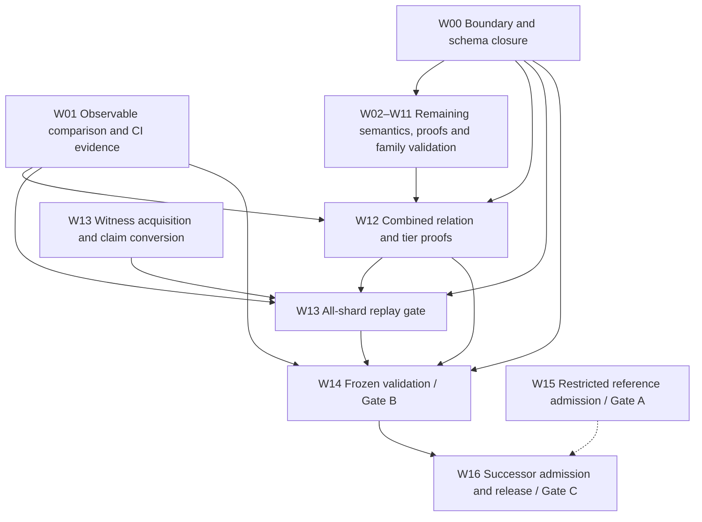

# Full Lean chunk transition — open work

Status as of 2026-10-27, main at `4382363b7` plus the kernel-map change below. Target: nearcore 2.13.4
(`44f7ae6cd7ef08bab604e20a473bf77e35d4c993`), PV86, pinned mainnet runtime parameters.

This is the open backlog only. Measured results live in the evidence directories under
[`docs/evidence/lean-chunk-completion/`](../evidence/lean-chunk-completion/); the review narrative
that used to be here (CI repairs, the smoke-table fix, the signed-tier correction) is preserved in
[`workplan-review-2026-10-25.md`](../evidence/lean-chunk-completion/workplan-review-2026-10-25.md).
Package IDs are stable: a package stays listed while any criterion is open.

The [transition plan](LEAN_CHUNK_TRANSITION_PLAN.md) defines the gates:

- **Gate A:** restricted reference independently checked and admitted live with signed evidence.
- **Gate B:** one executable transition covers every reachable target case with protocol resource
  behaviour and complete validation; prover capacity must not exclude valid inputs.
- **Gate C:** full relation and tiers frozen, independently admitted, packaged and released.

All three are open. AIR/PQ implementation, GPU proving and succinctness are not prerequisites.
Nearcore correspondence is tested unless a refinement proof is supplied.

## Where the successor stands

Combined figures are for `nearspec-v3-check-successor --tier allFeatures` built from `e8f79b34e`
(sha256 `bde46d67…`), compared with each case's recorded nearcore verdict.

| Evidence | Result |
|---|---|
| All six corpora, 235,716 cases | 235,397 agree; 95 out of domain (preparation-pipeline race), all nearcore-rejected; 224 Lean rejects in `d2corpus.v2`, whose witnesses carry no code and whose `ok` is the producer's verdict, not a cold one. No Lean accept of a nearcore-rejected chunk |
| All 577 committed fixture cases | 577/577 agree |
| 3,138-case gap census | `allFeatures` 3,138 accept; `signed` 2,403 out of domain / 735 accept (unchanged) |
| Corpus-wide **blind** replay, 39,942 non-mutant chunks (checker `29bf5217`) | 39,452 match all 11 header fields, 0 mismatches; 266 genesis, 224 `d2corpus.v2` |
| Per-outcome observables vs nearcore (17,338 chunks incl. mainnet shard 13) | 0 mismatches over 592,845 outcome fields, 439,552 receipt fields, 617,303 storage changes; 38,061 wrong-observable controls all detected ([full-observables](../evidence/lean-chunk-completion/full-observables/README.md)) |
| Mainnet shard 13, 1,223 consecutive chunks | verdict 1,223/1,223, blind 1,223/1,223 |
| Kernel-map change (`TTN.BMap`, checker `b65fe05c…`) re-run | verdict and reject reason unchanged on every case: 235,716 corpus (`allFeatures`), 577 fixtures and 3,138 census (both tiers) |
| Kernel non-vacuity (`decide +kernel`, no `native_decide`) | `RelD3`, `Tier.rel .allFeatures` on an honest chunk; both negations on a nearcore-rejected mutant; 199 s, 20.7 GB ([§12.1](../../spec/near-chunk-validation-d3.md#121-kernel-non-vacuity)) |

Pinned-nearcore fixture families, each with honest chunks, mutants, blind replay and a deliberate-
breakage control (agreement with nearcore at `allFeatures`; out-of-domain counts are named races):

| Family | Compared | Disagreements | Evidence |
|---|---|---|---|
| Curve hosts (12 alt_bn128/BLS, p256, ecrecover) | 229 verdicts, 181 blind | 0 | [curve-host](../evidence/lean-chunk-completion/curve-host-fixtures/README.md) |
| Key families, gas keys | 2,925 | 0 | [key-family](../evidence/lean-chunk-completion/key-family-fixtures/README.md) |
| ML-DSA-65 transactions, delegates, receipt keys | 533 honest + 3,886 mutants | 0 | [mldsa](../evidence/lean-chunk-completion/mldsa-fixtures/README.md) |
| Yield/resume | 8,834 | 0 | [yield](../evidence/lean-chunk-completion/yield-fixtures/README.md) |
| Storage limits (one-byte flips) | 3,098 | 0 | [storage-limit](../evidence/lean-chunk-completion/storage-limit-fixtures/README.md) |
| Real resharding splits (single, consecutive, threshold-driven) | 2,920 honest + 268 mutants | 0 | [resharding](../evidence/lean-chunk-completion/resharding-fixtures/README.md), [resharding-2](../evidence/lean-chunk-completion/resharding-fixtures-2/README.md) |
| Cross-family: yield under congestion, curve hosts from callbacks, post-genesis transactions, gas-key target side, rollback/refund | 33,182 | 0 (9 race exclusions) | [cross-family](../evidence/lean-chunk-completion/cross-family-fixtures/README.md) |
| Gate-B boundaries: 8 MiB+ witnesses, 1.8 Pgas chunks, segments to 71 blocks | 1,324 | 0 | [gate-b-caps](../evidence/lean-chunk-completion/gate-b-caps/README.md) |
| Fuel stress: 300 Tgas burns, stack and memory maxima | 180 | 0 | [fuel-termination](../evidence/lean-chunk-completion/fuel-termination/README.md) |

Proved in this round: tier lifts and genesis overlap (`TierProofs`, `GenesisOverlap`, `TierMono`), fuel monotonicity (more fuel changes only fuel-exhausted runs), curve loop
bounds, layout reachability at PV86 (`LayoutReach`), and kernel non-vacuity of `RelD3` and of
`Tier.rel .allFeatures`, each with its negation on real cases (`Examples/RealCaseD3`, run on demand:
~3.5 min, ~21 GB).

## Decisions taken (2026-10-26)

- **Signed statement (UQ-010).** The secp256k1 delegate widening moved 37 signed-tier verdicts: 35
  `out_of_domain → accept` on the 3,138 census and 2 high-s `reject → accept`. Nearcore accepts all 37.
  They are **accepted as a strengthening** of the signed statement
  ([record](../research/lean-chunk-w00-owner-map.md#32-uq-010-decision-record--the-secp256k1-delegate-strengthening-2026-10-26)).
- **ML-DSA-65 signatures** are implemented (FIPS 204 plus `ml_dsa_65_verification_cost`), not excluded.
- **W13 all-shard replay** waits on a machine the sponsor will provide
  ([runbook](../../tools/mainnet-replay/ALL_SHARDS_RUNBOOK.md)).
- **D3 kernel non-vacuity runs on demand**, like D1 and D2: `Examples/RealCaseD3` stays out of
  `defaultTargets` (≈21 GB peak; hosted CI runners have 16 GB). Run it with
  `HEAVY_MEM=40G /data/illia/nearproof-deps/bin/heavy lake build NearSpecV3.Examples.RealCaseD3`
  after any change to the checker's definitions.
- **Kernel-reducible maps.** `Wasm.TTN`'s byte-keyed `Std.HashMap`s (overlay, accounting cache,
  recorder) became `TTN.BMap`, a `Std.TreeMap` under lexicographic byte order, because the kernel
  cannot reduce `HashMap` (opaque `ByteArray.hash`, `USize` bucket index). This edits definitions
  in `checkD3`'s closure without changing their meaning; the signed challenges judge against their
  frozen trusted tree, which is unaffected. Compiled code's byte order is checked against the
  reference by `Wasm/CmpBytesTests.lean`.

## Open work, by what blocks Gate B

| # | Package | Open |
|---|---|---|
| 1 | W13 | 1,000-block all-shard window (hardware pending); the cold native adapter, without which `make w13-gate` cannot pass; finality/authentication boundary |
| 2 | W02 | Fuel sufficiency theorem: obligations O-W1b–O-W4 (`Wasm/Fuel.lean`; finite-wasm charges before execution is the largest). Evaluation time: a 300 Tgas receipt of zero-fee control loops needs ~55 h — bulk-skip such runs. Memory: ~106 B per witness byte |
| 3 | W02 | `w.compressed_size` approximates nearcore's 48 MiB compressed-witness limit (needs a zstd model or an authenticated length); total contract-code size (64 MiB) unmodelled; narrower tiers keep the old caps (UQ-012 tier design) |
| 4 | W12 | Tier refinement: segment, gas, witness-size, layout and genesis lifts proved for all three shells, the W10 genesis overlap proved, four named tier pairs proved ([tier-proofs](../evidence/lean-chunk-completion/tier-proofs/README.md)); 60 flag-contained tier pairs differ on no case except the two below. Open O1–O7 (floats, curve hosts, global actions, storage resolution, loading limits, resharding on non-genesis segments, complete-code). Signed `checkD3` rejects valid post-split V3 chunks (`InvalidBandwidthRequests`): a stated restriction of the signed statement |
| 5 | W08 | Historical/warm compiled-cache coherence; `completeCodeGlobal` rejects valid warm-cache chunks (178 on the tier census) and refines no tier; signed D3 tiers keep the pre-state code rule; generator labels race mutants `e.code_cache` |
| 6 | W00 | Open UQs: 001–004, 007, 010 (`DomainD3` reconciliation), 013–016, 017 (header set); fact authentication; versioned claim/witness schema |
| 7 | W01 | Failure kinds, per-receipt storage attribution and per-outcome compute are not compared; d1run/d2corpus.v2 lack expected per-outcome values |
| 8 | W03 | `WasmUnknownError` / resource `LinkError` reachability (UQ-014) |
| 9 | W04 | Float overlap/range proofs, preparation negatives, composition |
| 10 | W09 | Recorder-link / upper-bound proof (UQ-015) |
| 11 | W11 | Authentication and correctness/overlap proofs for the split; upgrade segments (PV84→86) are outside the pinned target |
| 12 | D3 | Kernel non-vacuity covers one honest chunk (no storage writes) and one code-drop mutant; a storage-writing, multi-receipt or resharding chunk is not yet kernel-checked (WASM preparation's list-backed `ByteArray.extract` limits contract size) |
| 13 | D1→D3 | `ZkFormal.PQ.Join.WitnessLift` existence (`Coverage.lean:191`); `ArmAgrees` is a hypothesis |
| 14 | W14–W16 | Frozen validation, Gate A admission, successor release |

Supporting research that is landed but carries no gate: the eleven `promise_*` encodings and the
`ripemd160` AIR row (open: `round_agrees`, the rotation bridge, feed-forward/digest rows, the
`X`-column message binding; see the review record).

## Dependency tree

Arrows are acceptance dependencies, not instructions to wait before coding.

W07/W08 share code-resolution and cache contracts; W07/W11 share obsolete-layout routing (UQ-006);
W09/W11 share trie accounting. W15's dashed edge means reusable admission tooling only.

## Acceptance requirements for outstanding work

Each remaining semantic change must satisfy transition-plan §5 and:

- Exercise executable successor paths through positive and discriminating negative whole chunks.
  Imports, standalone helpers and theorems that assume the missing result are insufficient.
- Bind pinned nearcore source, toolchains, parameters, oracle/checker binaries, inputs and outputs.
  Distinguish independent native outcomes from derived expectations and Python-reference evidence.
- Ground truth is pinned nearcore run cold. Produced values (roots, gas, receipts) are never inputs
  to Lean's computation; Lean computes them and they are compared (`--blind`).
- Cover each new branch/boundary with deliberate-breakage controls; at least 1,000 generated
  comparisons per new semantic family across at least four recorded seeds, plus directed tests.
- Compare computed roots, outcomes, gas/compute, refunds, logs, return data, receipts, writes and
  rollback. Missing results, crashes, timeouts and unsupported valid cases are not matches.
- A Lean accept of a nearcore-rejected chunk is a soundness bug. Nondeterminism in nearcore (thread
  races) is a named out-of-domain reason, never an accept.
- Build changed declarations and actual drivers; audit transitive axioms. Only `propext`,
  `Classical.choice` and `Quot.sound`; no `sorryAx`, semantic axioms or `native_decide`.
- Record package identity, counts/seeds, residual premises and remaining failures.

Shared checker, dispatch, codec, claim schema, root import and Lake target changes need one
integration owner. Preserve signed definitions and oracle pins (`make pin-check`). A semantic
correction invalidates affected evidence. Final whole-corpus replay is W14.

## Packages and success criteria

### W00 Boundary inventory and schema closure (L0 + integration)

Settle the canonical predicate, the remaining rejection guards, trusted facts and the 17 UQs in the
[inventory](../research/lean-chunk-coverage.md); finalize versioned claim/witness extensions and
boundary-fact contracts. **Success:** every open row/UQ has an owner, a source-backed disposition and
a test/proof obligation; nothing is relabelled complete to close Gate B.

### W01 Computed observables and CI validation (L7 + integration)

Landed: header-level outputs (`--emit`/`--blind`) and per-outcome observables (`--emit-full`/
`--blind-full`: outcomes, return data, logs, outgoing and refund receipts, committed storage changes,
compute) compared with nearcore on 17,338 chunks, with wrong-observable controls. Open: failure kinds,
per-receipt storage attribution, per-outcome compute; expected values for d1run/d2corpus.v2; the
corpus-content CI gate on a provisioned runner.
**Success:** every required case has an asserted outcome and complete observable comparison.

### W02 Protocol capacity and evaluator totality (L1)

Landed: `wasmFuel` from the gas and block limits with monotonicity proofs; every arena cap on
`allFeatures` lifted or replaced by nearcore's rule (50 limit constants checked against PV86); full
236,293-case rerun with no drift; boundary and stress fixtures with runtime/memory figures. Open: the
fuel-sufficiency theorem (O-W1b–O-W4); an exact compressed-witness limit; total code size; evaluator
speed and memory for W16 budgets; the two 64-draw shuffles (negligible false-reject chance).
**Success:** no valid execution is rejected as fuel exhaustion or a prover-derived cap.

### W03 Remaining runtime-error semantics (Wasm owner + L7)

Resolve `WasmUnknownError` and resource `LinkError` reachability (including execution-slot retry
exhaustion) from pinned source. **Success:** no reachable environment failure is assumed absent or
renamed a domain exclusion.

### W04 Float proof and composition closure (L2)

Chunk-level old/new agreement on the overlap, arithmetic range/fuel obligations, preparation
negatives, cross-family composition. **Success:** proofs and composition checks pass; engine
agreement is not presented as an IEEE/nearcore refinement theorem.

### W05 Curve whole-chunk validation (L3)

Landed: all 12 alt_bn128/BLS hosts, `p256_verify`, `ecrecover` as whole chunks, including register
and out-of-bounds inputs and calls from callbacks and promise chains. Open: calls from timed-out yield
callbacks; post-NEP-488 `version = 1`. **Success:** every target curve host has whole-chunk parity evidence on every entry path.

### W06 Transaction and delegate key families (L3 key substream)

Landed: secp256k1 tx and delegate verification (high-s rule), ML-DSA-65 keys, signatures
(`MlDsa65.lean`, pinned to NIST and nearcore vectors) and verification cost on every entry path, the
key/signature type mismatch, transaction wire size; whole-chunk fixtures with 0 disagreements. Open:
a `z` coefficient exactly at the norm bound in an otherwise valid signature (cannot be generated). **Success:** every reachable key/signature
variant decodes and verifies on each entry path with trie parity.

### W07 Remaining actions and hosts (L4)

Landed: global actions, distribution receipts (routed to split children), promise hosts, gas keys
on both shards, yield/resume including under congestion, rollback/refund/emitted-receipt composition.
Open: mismatched distribution code identities (with W08); state init followed by a successful emit
(always `BalanceExceeded` in the generator). **Success:** every required promise/action shape executes on real tries with matching
fees, nonces, receipts and rollback.

### W08 Cache identity and environment closure (L1 + L4)

Landed: deploy-tracker resolution and the preparation-pipeline rule (`Successor/Pipeline.lean`).
Open: historical/warm compiled-cache coherence; `completeCodeGlobal` rejects valid warm-cache chunks
and refines no tier; the pipeline rule in the signed D3 tiers; the cold native adapter for W13; the
generator's `e.code_cache` label on race mutants. **Success:** every code
resolution case is deterministic and justified, or rests on an authenticated input.

### W09 Storage boundary validation and bounds (L5)

Landed: one-byte nearcore flips of the per-receipt and chunk soft limits (3,098 verdicts, 0
disagreements). Open: the recorder-link/upper-bound proof (UQ-015); split and global-code
composition at the limit. **Success:** independent boundary evidence and observable parity validate
the accounting.

### W10 Genesis proof and fact closure (L6)

Landed: post-genesis chunks with transactions and implicit transitions; nearcore never builds a
genesis chunk with transactions (zero tx root), so `tx_valid` on genesis is reachable only empty.
The genesis/non-genesis overlap is proved (`checkD2CoreGWith_overlap`, `checkD2CoreG_overlap`). Open: genesis fact
authentication; the UQ-017 header comparison set. **Success:** overlap theorem and transaction-bearing cases pass.

### W11 Resharding boundary validation (L6 resharding substream)

Landed: real dynamic splits (2,920 PV86 witnesses: single, consecutive and threshold-driven splits,
walks across two layout changes, storage-limit and distribution compositions) with `ReshardCore`/
`TrieSplit`/`Routing`; UQ-009 closed by `LayoutReach` and the PV84→86 mainnet schedule. Open:
authentication and correctness/overlap proofs. **Success:** genuine
split fixtures match nearcore; no valid layout/split exclusion remains.

### W12 Full combined relation and tier proofs (integration + L1)

`allFeatures` is the candidate union; the named wide tiers are not cumulative and
`completeCodeGlobal` is not an ancestor. Landed: tier lifts, genesis overlap, cross-family fixtures,
and kernel non-vacuity of `RelD3` and `Tier.rel .allFeatures`. Open: tier obligations O1–O7 and
old-domain agreement proofs (open item 4); broader kernel cases (open item 12). **Success:** composition and proofs pass on a buildable package.

### W13 Authenticated mainnet witness replay (L7)

Landed: shard-13 diagnostic, blind. Open: the 1,000-block all-shard window (hardware pending); the
cold native adapter; the finality/authentication boundary. Use the
[replay gate](../../tools/mainnet-replay/README.md) and
[capture launcher](../../tools/mainnet-replay/nearcore-capture/README.md). **Success:** `make
w13-gate` reports 100% replay coverage, 100% verified matches and zero mismatches, unsupported
cases, missing witnesses or errors. `mismatch_percent` is `null` (N/A) with no comparisons.

### W14 Frozen validation and Gate B (L7 + integration)

Freeze one W12 package; replay D1 53,048, D2 67,384 and D3 115,284 cases plus every fixture set and
W13 on it; clean builds, axiom/runtime audits, resource measurements; one manifest binding code,
toolchains, parameters, commands, binaries, inputs and outputs. **Success:** the frozen package meets
every Gate B obligation.

### W15 Restricted reference admission / Gate A (L8)

Bind the exact restricted relation and trusted tree to artifact hashes, run the configured formal
checks and conformance, and archive signed live **ADMITTED at formal tier** evidence. Local or
unsigned PASS is insufficient.

### W16 Full successor admission and release / Gate C (L8 + integration)

Freeze the full relation, tiers, canonical encoding and fact provenance; pin the successor
challenge; obtain its own signed admission; demonstrate contributor instructions for another proof
system; authorized release. This workplan does not authorize external release.
