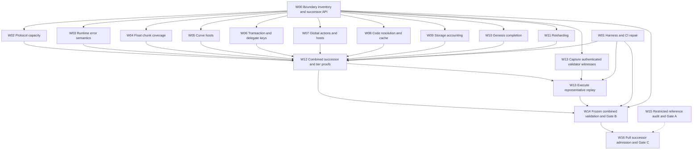

# Full Lean chunk transition completion workplan

Date: 2026-10-23. Source baseline: `main` at `e34852568`.
Target: nearcore 2.13.4, commit `44f7ae6cd7ef08bab604e20a473bf77e35d4c993`, PV86,
pinned mainnet runtime parameters.

The remaining work is to join the implemented extensions into one executable successor relation,
complete reachable protocol semantics, and validate that combined transition before releasing its
reference implementation. Work can proceed concurrently on arithmetic, actions, storage, resharding,
fixtures and admission. Changes to the shared checker, codecs and dispatch need one integration owner.

This is the detailed execution companion to the
[transition plan](LEAN_CHUNK_TRANSITION_PLAN.md). That plan's Gates A/B/C remain authoritative.
This workplan defines proposed work packages and acceptance dependencies; it does not assign people,
start agents, certify completion or authorize signing/deployment. Lane names below identify the
natural existing owners, who must claim work in their lane logs.

## Current progress update

Integration snapshot: **2026-10-24, merge `c3976e326`**, based on main `e44e2cdbd`.
All committed work at the inspected L0/L1/L2/L4/L5/L6/L7/L8 tips is integrated.
L4's six commits through `06dffaac6` are newly merged. **W05 is explicitly held back**:
L3's seven pending commits through `4a333be4e` remain on its branch; existing main BLS code is
preserved. Branches and worktrees remain available for continued work and later reconciliation.
The [earlier audit](../logs/lean-chunk-lane-audit-2026-10-24.md) is historical evidence, not the
current merge ledger. Its L3 test findings must be rechecked against any subsequent lane fixes.

**No completion gate has closed: Gate A 0/1, Gate B 0/1, Gate C 0/1.** The inventory is
**222 rows: 147 implemented, 36 validated, 5 missing, 23 partial, 11 impossible-at-boundary**.
The five L4 missing→partial moves recognize additive implementation, not new validated acceptance.
There are still 28 missing/partial rows. Counts are not an estimate of remaining effort, and the
inventory's impossibility classifications do not settle every open boundary question.

### Execution checkpoint — W05 excluded

Code checkpoint `25efc7265` is promoted to main; branch `work/lean-completion-except-w05-20261024`
remains available for further work. See the
[execution log](../logs/lean-chunk-completion-2026-10-24.md) for exact evidence and residual obligations.

- **W01:** executable driver for every current configuration, strict process/output accounting,
  artifact/input/output hashes and mixed-exclusion/gas-band comparison fixes are implemented.
  Computed chunk-observable reporting remains open.
- **W03:** the pinned pooling `LoadingError` branch is implemented in the successor and matches
  1,030 independent full-output cases across four seeds. It passes 209 whole-chunk comparisons
  (204 accepts, five retained unrelated exclusions), with four committed chunk fixtures and
  removed-check controls. Another 366 mutant cases agree (298 rejects, 68 accepts).
  Remaining runtime-error/environment branches and final validation stay open.
- **W04:** 2,050 exact full-output comparisons cover all 70 numeric float operators (1,960 successes,
  90 traps); 224 chunk comparisons pass (200 accepts, 24 residual exclusions). Input-driven
  bundles pass 32 runtime comparisons and 1,284 generated chunk comparisons (1,200 accepts,
  84 retained exclusions; 300 accepts per seed).
  Another 350 mutant expectations pass (302 rejects, 48 accepts; expectation provenance is recorded).
  Overlap proof, preparation negatives and full cross-family composition remain open.
- **W12:** combined gas/float/genesis has a 1,788-case verdict checkpoint. The new runtime configuration
  adds loading limits; full composition, tier proofs and release validation remain open.
- **W02:** no whole-checker gas-cap theorem has landed; keep its proof and capacity criteria open.
- **W13:** witness-source information is pending. **W05** remains with the other agent.
  No complete W00–W16 package or Gate A/B/C is certified by this checkpoint.

### Action code resolution and storage execution checkpoint — 2026-10-24

The `storageResolution` successor tier composes runtime limits, floats, protocol gas and genesis
with actual chunk-scoped recording and FunctionCall identifier resolution. The signed checker
and the seven earlier tier configurations retain their original dispatch. The parameterized
validation shell has `rfl` checks against both original core validators at its legacy driver.

- **W08 implemented:** local/global-by-hash/global-by-account code dispatch; all four legacy wallet
  magic hashes redirect using the current chain; account identifiers survive successful calls.
  Global-by-account lookup reads the value reference without requiring the code blob. Missing
  identifier, missing proof and missing code remain distinct errors. The cold-cache exclusion
  remains explicit; no unauthenticated warm-cache input was introduced.
- **W09 implemented:** deduplicated authenticated node/value reads, non-rollback removal charges,
  shared VM accounting cache, one proof baseline per action receipt, per-receipt exhaustion and
  chunk soft-limit deferral across local/delayed/incoming receipts and yield timeouts. The merged
  witness-size overestimate is disabled only in this tier; the 8 MiB serialized witness cap remains.
- **Evidence:** 388 targeted cases (161 ETH-local accepts, 227 residual exclusions) and 1,788 broader
  comparisons (1,503 accepts, 134 rejects, 151 residual exclusions) agree with recorded expectations.
  Native tests cover strict boundaries, two calls sharing a receipt budget, reset between receipts,
  reference-only global lookup, cross-chain wallet resolution, identifier preservation, deduplication,
  and rollback after 2,001 removals followed by deferral. CI includes four ETH-local chunk fixtures,
  20 existing honest runtime/float chunks and four existing mutants in the new tier.
- **Open at that checkpoint (superseded for W07/W08 by the next checkpoint):** global action
  dispatch, code-witness policy and positive global windows. W09 still needs independently
  generated nearcore chunks at exact proof limits, full observable comparison, implicit/resharding
  composition and resource bounds. Native directed tests are not independent nearcore boundary
  comparisons. No whole W08/W09 package or completion gate is certified; W05 is untouched.

See [implementation and handoff](../logs/lean-chunk-storage-resolution-2026-10-24.md) and
[replay evidence](../evidence/lean-chunk-completion/storage-resolution/README.md).

### Cache closure and global action integration — 2026-10-24

Integrated from parallel lanes onto main baseline `197767793`; **W05 remains excluded**.
The [handoff](../logs/lean-chunk-cache-global-2026-10-24.md) records implementation, evidence and
remaining obligations. `globalActions` adds deploy/use/state-init actions and distribution receipts
through versioned witness, transaction, delegate, postponed and buffered receipt decoding, recorded
action execution and shard routing. All seven global/state-init promise hosts now produce executable
actions. `completeCodeGlobal` adds an explicit complete-code witness requirement.

- **W07 delivered:** tags 9/10/11, distribution V1/V2 freshness/forwarding, fees, storage usage,
  third-party state-init, refunds and rollback; per-receipt promise indices; Borsh map normalization
  and canonical transaction/delegate hashes. Twelve independent Rust codec vectors pass.
- **W08 delivered:** hash-verified raw code, authenticated pre-state origin checks and current/
  committed deployment or distribution materialization; attempted failed deployment code cannot
  satisfy the complete policy. Missing required code is `w.code_complete`, a witness admission
  failure rather than a claim that every native cache history rejects the protocol chunk.
- **Independent evidence:** 265 selected cases per tier: 162 accepts, 99 rejects, four retained
  unrelated key/crypto exclusions. Of 99 honest cases, 95 accept; all 166 mutants agree with their
  raw oracle expectations. Another 83 promise-host chunks accept in each tier. Fourteen code-only
  mutant pairs pass 84 repeated complete/incomplete/restored policy checks; raw incomplete native
  outcomes (nine accepts, five rejects) remain separate. CI retains 26 accepted global chunks,
  two explicit key exclusions, three promise controls and five code-policy pairs.
- **Remaining:** gas-key hosts/actions; old-layout distribution ancestry; mismatched distribution
  code identities and historical compiled-cache coherence; broader postponed/yield and wallet/cache
  composition; full observable export, overlap proofs and final representative replay. Complete-code
  admission does not prove equality with arbitrary poisoned or warmed native cache histories.
  **W07/W08 and Gates A/B/C remain open.**

### Remaining work by package

Each row states what is available and what must still satisfy the detailed success criteria below.
No W00–W16 package is certified fully complete by this merge.

| Package / owner | Available now | Remaining completion obligation |
|---|---|---|
| W00 / L0 + integration | Seven successor interfaces, owner map, default-build inclusion, gas/float/genesis configuration | Connect real host/action/recorder execution; settle boundary questions and versioned facts/codecs; complete canonical relation and interface proofs. |
| W01 / L7 | Seven executables built; eight configurations smoked; strict replay with artifact/input/output hashes and failure controls | Emit and compare computed chunk observables (roots, outcomes, gas, receipts, writes and rollback); validate the completed combined successor. |
| W02 / L1 | Protocol-gas checker, measured above-cap acceptance | Fuel/termination and protocol-scale memory/stack bounds; remove arena-only segment/size limits; stress limits and prove overlap/tier inclusion. |
| W03 / Wasm owner + L7 | Pooling allocation semantics, 1,030 exact output comparisons and 209 chunk comparisons; ablations and CI regressions | Complete remaining runtime-error/environment reachability audit and validate the final combined package. |
| W04 / L2 | Float kernel; 2,050 full-output cases covering 70 operators; eight fixed and eight input-driven contracts; 1,284 input-driven chunk comparisons (1,200 accepts); CI fixtures | Complete overlap proof, preparation negatives and remaining cross-family execution; 350 mutant expectations now pass. |
| W05 / L3 — held back | Main has ecrecover/p256 and nine BLS host implementations; pending branch adds BN128 and followups | Reconcile and validate pending checkpoint in a later merge, including fixture failure controls; connect all curve hosts to accepted chunks and verify gas/error/state parity. |
| W06 / L3 keys | Existing Ed25519 paths | secp256k1 transactions/delegates and ML-DSA-65 codecs, verification, key handles and trie integration; positive/negative chunks with fees/nonces/roots. No W06 completion inferred from W05. |
| W07 / L4 | Integrated global deploy/use/state-init, distribution, seven promise hosts; independent chunk and canonical-codec checks | Complete gas-key translation, obsolete-layout ancestry and mismatched code identity semantics; broaden observable/error/rollback composition and prove overlap. |
| W08 / L1 + L4 | Identifier-preserving resolution plus tested complete-code witness policy; global/by-account/deploy/rollback chunks and paired incomplete-code evidence | Close historical compiled-cache identity boundary; broader postponed/yield/wallet preparation tests, authenticated environment contract and overlap proof; full observable comparison. |
| W09 / L5 | Executable chunk recorder, per-receipt exhaustion, chunk deferral, rollback-preserved read/removal accounting; native boundaries and regression replay | Independent nearcore exact-limit chunk fixtures, full observable parity, implicit/resharding composition and resource bounds. |
| W10 / L6 | Corrected genesis checker, 137 recorded new accepts, gas/float/genesis composition | Non-genesis overlap proof, genesis transaction-flag negatives, authenticated facts and combined-entry validation. Preserve header-mutant regressions. |
| W11 / L6 | Boundary analysis/interface | Actual resharding retention, child state/buffers/congestion and epoch transitions; real layout-boundary fixtures and mixed-protocol reachability resolution. |
| W12 / integration + L1 | Partial gas/float/genesis composition; additive family adapters | One executable W02–W11 relation; all required families reachable; tier/overlap proofs and cross-family tests. Seven global/state-init hosts are enabled; remaining required host/key families still need composition. |
| W13 / L7 | Mainnet capture/import and explicit fail-closed replay gate with mismatch/coverage reports; live 30-chunk metadata probe | Acquire and execute authenticated witnesses for at least 1,000 consecutive PV86 blocks across all shards, plus rare-feature fixtures; complete observable/hash reports. |
| W14 / L7 + integration | Lane-specific checks and replay evidence | Freeze one full package after W12; replay D1/D2/D3 plus generated/cross-family/W13 suites; close all UQs, audit axioms/runtime, publish reproducible identity and Gate B record. |
| W15 / L8 | Admission workflow available for audit | Exact restricted-reference artifact binding, formal/kernel/conformance/resource checks and archived signed live formal-tier ADMITTED evidence; clean-checkout instructions. Can proceed now. |
| W16 / L8 + integration | Release requirements specified | After W14, freeze trusted relation/tiers and challenge; independently admit full successor, finish contributor instructions and authorized release with Gate C evidence. |

### Integration consequences and parallel priorities

1. **Shared integration first:** L0/integration exposes the executable adapters for host dispatch,
   versioned actions/receipts, resolution and recorder. L4's `checkD3Global` still calls old D2
   decoders; its `pActL4` is standalone. Use the new `storageResolution` path for calls and recording;
   the older normalization delegate is not the integrated execution path.
2. **Parallel semantic work:** L1 capacity, L2 float coverage/runtime errors, L3 held-back curves and
   separate key work, L4 actions/resolution, L5 recorder, L6 genesis/resharding. Consume the shared
   interfaces rather than forking independent complete checkers. W07/W08 and W09/W11 must coordinate.
3. **Start evidence/admission now:** L7 can build observable/hash reporting and acquire witnesses;
   L8 can audit the restricted reference. Final full replay waits for the combined successor.
4. **Critical completion chain:** W00 adapters → W02–W11 semantic closure → W12 combined relation
   and proofs → W13 completed replay + W14 frozen validation → W16 admission/release.
   W15/Gate A can close independently. The dependency graph below remains authoritative.

L4's 539-case replay shows unchanged verdicts/reasons, not positive new execution. Generate missing
global/distribution/wallet cases with versioned successor tooling while preserving the pinned
oracle. **UQ-006 remains open:** non-instant distribution receipts alone do not prove exclusion from
source receipt proofs; the lane log's stronger impossibility claim is not accepted as closure.

Validation for this integration is recorded in
[the merge handoff](../logs/lean-chunk-integration-except-w05-2026-10-24.md).

## Original baseline state and scope

### Completed foundations to preserve

| Area | Available at the baseline | What this does not establish |
|---|---|---|
| Inventory | 222 drift-checked rows: 147 implemented, 36 validated, 19 missing, 9 partial, 11 impossible-at-boundary | Row counts are not a percentage of full semantic completion; some rows aggregate entire families. |
| L1 capacity | Additive protocol-gas checker; real above-cap example, 25/25 sampled band accepts and 12/12 overlap samples | Tier/overlap proofs or protocol-scale termination and resource bounds. |
| L2 floats | Pure Lean bit-pattern operations, 141 kernel tests, separate float and float-plus-protocol-gas checkers | Varied generated whole-chunk coverage or integration with every other extension. |
| L3 crypto | ecrecover and p256 arithmetic and additive host functions, vector/gas/error tests | Reachability through an accepted chunk checker, remaining curves or transaction key families. |
| L4 global actions | Additive codecs, resolution, fees, action bodies and 134 root-imported directed tests | Successor action/receipt/host dispatch or validated whole-chunk semantics. |
| L5 storage | Recorder-bound analysis and conditional sufficiency/protocol-limit facts | Actual protocol accounting and exhaustion behaviour. |
| L6 genesis | Corrected additive checker: 137 genesis cases newly accepted, zero non-genesis changes across 115,147 recorded cases; 16 directed negatives | A common successor, general overlap theorem, actual resharding or genesis transaction-flag coverage. |
| L7 validation | Corpus manifests, replay evidence, harness controls and runtime-error reproducers; v3 added to CI and `make lean` | Complete comparisons, executable mainnet witness replay or all required build targets in CI. |

The old L6 holdback is resolved by `bcbfd97f1`, merged through `4d4fd40c3`. Its first draft accepted
307 header mutants; the corrected non-genesis path delegates to `checkD2Core`. Do not reimplement
that tail independently during integration.

The [first integration record](../logs/lean-chunk-integration-2026-10-23.md) describes `b2f83fe76`,
not the latest state. [L1 evidence](../logs/lean-chunk-L1-2026-10-23.md),
[L7 evidence](../logs/lean-chunk-L7-2026-10-23.md), the
[L4 exclusion replay](../../evidence/lean-chunk-L4/replay/d3-hook-replay-summary.json), and current
source provide the subsequent changes. Historical claims that floats/crypto are absent from main,
or that v3 has no CI build, are superseded. Recorded replay counts are carried-forward evidence,
not a fresh combined-successor run.

### Three outcomes

- **Gate A:** the restricted reference is reproducibly checked and admitted live, with signed evidence.
  It can close independently of full semantics.
- **Gate B:** one executable PV86 transition covers every reachable target case, with protocol resource
  behaviour and all required validation. No valid case is excluded for a prover's capacity.
- **Gate C:** that full relation and its coverage tiers are frozen, packaged, admitted and released.

AIR/PQ implementation, GPU proving and succinctness are not prerequisites. Formal equivalence with
nearcore is a separate project. Candidate-to-Lean soundness, tier inclusion and checker facts are
proof obligations; correspondence with nearcore is tested unless an actual refinement proof exists.

## Dependency tree and parallel execution

The dependency structure is a directed acyclic graph because several workstreams share inputs.
A solid arrow below means the downstream milestone cannot close until its predecessor is accepted.
It does **not** mean all downstream coding must wait. The table after the graph defines the start
conditions and the precise acceptance dependencies.

W07 and W08 share a contract-resolution interface; W09 and W11 share a trie-accounting interface.
Agree these in W00 rather than making either pair wait for the other's entire implementation.
W06 may reuse W05 secp arithmetic, but the arithmetic already exists; missing BN128/BLS work is not
a prerequisite for transaction-key work. W15 has no dependency on the semantic lanes. Its dashed
edge to W16 means reusable admission tooling/evidence structure, not a hard prerequisite: Gate C
requires the successor's own admission checks, not prior admission of the restricted reference.

### Work package dependencies

“Close after” lists direct acceptance prerequisites. W12 consumes accepted semantic packages
incrementally; it is the combined milestone, not a final bulk merge after all development stops.

| ID | Package | Suggested owner | Work that can start immediately | Close after |
|---|---|---|---|---|
| W00 | Boundary inventory and successor API | L0 + integration owner | Audit, interface design, ownership of uncovered rows | None |
| W01 | Harness and CI repair | L7 | Comparison fixes, CI provisioning/build coverage, manifest tooling | None |
| W02 | Protocol capacity | L1 | Fuel/resource audit, boundary fixtures, monotonicity proofs | W00 |
| W03 | Runtime error semantics | L7 + Wasm owner | Instance-layout model and directed reproducer | W00 |
| W04 | Float whole-chunk coverage | L2 | Contract generator and operator/NaN/trap cases | W00 |
| W05 | Curve host completion | L3, separable by curve | BN128, BLS, host dispatch design, independent vectors | W00 |
| W06 | Transaction and delegate keys | L3, separate key owner | secp verification, ML-DSA codecs/arithmetic/trie representation | W00 |
| W07 | Global actions and excluded hosts | L4 | Distribution receipt semantics, generators, action/host tests | W00 |
| W08 | Code resolution and cache | L1 + L4 | Pinned cache/deployment audit, code-loading fixtures | W00 |
| W09 | Protocol storage accounting | L5 | Recorder model, exhaustion/defer/rollback cases | W00 |
| W10 | Genesis completion | L6 | Delegation theorem and transaction-flag tests | W00 |
| W11 | Resharding and boundary transitions | L6, separate resharding owner | Trie split/congestion model and validator fixture generation | W00 |
| W12 | Combined successor and tier proofs | Integration owner + L1 | API skeleton, adapters, early cross-family tests | W00–W11 |
| W13 | Authentic representative replay | L7 | Witness capture/provenance tooling and window selection | W00, W01, W12 |
| W14 | Frozen combined validation | L7 + integration owner | Evidence schema, closure audits, regression orchestration | W00, W01, W12, W13 |
| W15 | Restricted reference admission audit | L8 | Inspect existing signed reports and exact reference package | None |
| W16 | Full successor release | L8 + integration owner | Contributor/encoding/tier documentation drafts | W14; reuse W15 tooling where available |

Every W02–W11 package must pass the common acceptance contract below before W12 can close. W01
provides the shared harness, but local directed/vector work should not wait for W01 completion.
W13 may capture raw authenticated witnesses before the final claim format is settled; conversion
and acceptance must use the agreed W00 format and W12 checker.

### Parallel work waves

| Wave | Work to run concurrently | Exit condition |
|---|---|---|
| Start | W00 and W01; W15 admission audit; W13 witness acquisition prototype; all semantic lanes' isolated arithmetic/audits/generators | W00 publishes the shared interfaces and owner map; no global stop-the-world inventory prerequisite for independent work. |
| Semantic implementation | W02–W11; W13 capture; W12 continuously integrates accepted increments | Each family has an accepted path, generated fixtures and negative controls; integration uses one shared implementation. |
| Combined closure | W12 cross-family/tier proofs; W13 executable replay; W14 fresh builds, corpora and evidence | All Gate B obligations pass on one frozen commit/package; any correction invalidates and reruns the affected evidence. |
| Release | W16, using W15's admission experience and W14's frozen relation | Successor signed/deployed under existing authorization and reference admitted live; contributor path demonstrated. |

No elapsed-time estimate is implied. Likely substantial work lies in curve/ML-DSA semantics,
protocol storage accounting, resharding and obtaining real validator witnesses. These are parallel
branches that converge at W12/W14; there is no measured critical-path duration yet.

## Shared interfaces and integration ownership

W00 must publish concrete types or signatures, an initial compiling adapter and an owner for each
shared file before competing implementations land. The exact API names are an implementation choice.

| Interface | Required contract | Consumers |
|---|---|---|
| Canonical checker and tiers | One semantic root; explicit protocol configuration and tier predicates; old signed entry points preserved | All lanes, W12, W16 |
| Wasm host dispatch | Additive successor host table with explicit real-state/gas/error semantics; no host-result oracle | W03–W07 |
| Actions and receipts | Versioned decoding/encoding, tags, dispatch and rollback; distribution receipts and new key forms represented | W06, W07, W09 |
| Contract resolution | Local/global/ETH-wallet identifiers, code lookup, deploy tracking and defined cache environment | W07, W08 |
| Trie recorder | Read/write/remove/code access, per-receipt accounting, chunk soft-limit state and rollback | W08, W09, W11 |
| Boundary facts | Genesis, epoch/layout/split inputs and authentication; distinguish external facts from computed transition outputs | W10, W11, W13, W16 |
| Differential result | Every input produces a result/error; explicit expected domain, verdict and observable fields; no skipped cases counted as matches | All test lanes, W13, W14 |

The integration owner owns shared edits to `ChunkValidationD2.lean` or its successor,
`D3/FunctionCall.lean`, `Wasm/Exec.lean`, `Wasm/Host.lean`, `D2/Types.lean`, root imports,
Lake targets and claim/witness schemas. Ownership does not mean extending the old signed relation:
shared factoring must preserve it, and broader behaviour belongs to the successor.

Lane owners build isolated modules and submit small adapter patches. L0 owns inventory schema and
row reconciliation; L7 owns the common harness/evidence schema. Regenerate the inventory from the
merged source instead of accepting whichever generated JSON appears last in a merge.

Use one worktree per lane, with no hard-linked `.lake` caches. Rebase/reconcile from the current
integration base before changing shared interfaces. Build libraries and executables before replay;
never rebuild an executable under a running replay. Preserve other lanes' uncommitted changes.

## Acceptance contract for every semantic package

Each package's criteria below supplement, rather than replace, transition-plan §5.

1. **Executable reachability:** at least one test exercises the new behaviour through the successor
   checker. A module import, unused implementation or theorem with the semantic result as a premise
   does not count as an implemented accepted path.
2. **Pinned correspondence:** record nearcore source, compiler/toolchain, runtime parameters, oracle
   build recipe, executable hashes, fixture hashes and exact commands. Compare against independently
   produced pinned nearcore outcomes; label Python-reference provenance accurately.
3. **Directed coverage:** exercise every new branch and boundary with success and discriminating
   failure where possible. Include a controlled breakage/removal experiment that makes a targeted
   test fail. Exact error-kind quotient is permitted; unexplained outcome/gas differences are not.
4. **Generated coverage:** at least 1,000 generated comparisons per new semantic family across at
   least four recorded seeds, in addition to directed cases. Report per-family/per-seed counts;
   do not substitute repeated directed cases for generated cases or silently aggregate unrelated families.
5. **Chunk observables:** validate state/outcome roots, gas/compute, refunds, logs, return data and
   emitted receipts, with honest witnesses plus tampered claim/witness/code/fact cases as applicable.
   No timeout, crash, truncation or missing result is a successful exclusion.
6. **Formal/build closure:** compile the actual changed declaration closure and driver; audit all new
   theorems' transitive axioms and runtime restrictions. Allowed logical axioms are `propext`,
   `Classical.choice`, `Quot.sound`; no `sorryAx`, new semantic axioms or native shortcuts.
7. **Handoff:** commit code, tests, fixture manifest and lane log with exact tip, remaining premises,
   failures and next step. Mark inventory rows validated only for the path and evidence actually tested.

Full combined D1/D2/D3 and real-window replay is a W14 release gate; individual lanes must run the
relevant subset before integration and preserve previously accepted unchanged-domain cases.

## Detailed work packages

### W00 Boundary inventory and successor API

Owner: L0 plus integration owner. Current inventory and row statuses are in
[coverage JSON](../research/lean-chunk-coverage.json) and the
[readable inventory](../research/lean-chunk-coverage.md).

Deliver a reconciled inventory and a compiling successor API. Resolve which checker/predicate is
the statement of record: `Wasm.DomainD3` contains predicates disconnected from or stricter than
actual dispatch. Map every rejection/domain guard, variant and trusted fact to a concrete owner.
Add explicit transaction/delegate/ML-DSA obligations rather than assuming the curve-host rows cover them.

Reconcile the unresolved-question register: preserve L4's PV86 global-wallet answer and L6's genesis
answer, settle cache/environment semantics, protocol-activation segments, size limits, gas schedules,
resharding witness representation and trusted-fact authentication. Treat `unmodeled` invariant paths
as proof/test obligations until they are justified unreachable for valid prepared inputs.

Success criteria:

- Every inventory row and every recorded UQ has an owner, disposition, source justification and test
  obligation. Unknown answers are explicitly open and block Gate B.
- The API contracts above are written and compile with existing float/gas/genesis adapters.
- A schema decision states which existing claim fields suffice, which need a versioned extension,
  and how external facts are authenticated. No computed state-transition result is admitted as a fact.
- The inventory generator's drift check passes and IDs are unique. Static status and evidence are
  distinguished; unresolved implementation work cannot disappear by relabelling an exclusion.

### W01 Harness and CI repair

Owner: L7. The new CI manifest invocation in
[ci.yml](../../.github/workflows/ci.yml) requires corpora despite its comment claiming otherwise.
[corpus_manifest.py](../../tools/d3/corpus_manifest.py) exits when the corpus directory is absent.
Provision content-addressed pinned corpora, or run that job on an appropriate runner. A schema-only
manifest test may run without corpora but must not be called a corpus-content drift check.

Repair [the D3 harness](../../oracle/v3-d3/tools/difftest_d3.py) so every required case is compared
against an explicit expectation for the selected relation. The L7 audit found 1,259 verdicts compared
to nothing in the general baseline sweep. Keep baseline-domain and successor-domain expectations
separate; do not “fix” this by forbidding legitimate new acceptance or by tolerating new exclusions.

Add explicit build/test coverage for genesis, resharding and oracle drivers: the root's default
build does not include every Lake executable or source file. Create machine-readable per-case output
and the full observable comparison contract. Preserve and extend wrong-checker controls.

Success criteria:

- A clean hosted/job environment either obtains verified corpora and checks bytes or runs a distinctly
  named lightweight test; no dependency on an unprovisioned developer-local path.
- The comparison report partitions every input exactly once, with no missing outputs. Expected domain
  exclusions have an asserted reason/classification, not an unconditional pass.
- Wrong verdicts, wrong observables, missing lines, crashes and timeouts make the appropriate gate fail.
- Required successor modules and drivers are actually built by CI; CI definitions are exercised, not
  accepted solely because YAML contains a command.
- Per-case outputs, package identities and manifests support W12–W14 without reconstructing provenance
  from scattered logs.

### W02 Protocol capacity and evaluator totality

Owner: L1. Reuse [the gas successor](../../spec/lean/v3/NearSpecV3/ChallengeChunkV3Gas.lean) and the
[L1 band evidence](../logs/lean-chunk-L1-2026-10-23.md); the existence of above-cap cases is done.

Audit the fuel formula in `D3/FunctionCall.lean`, every other finite evaluator allowance and
recursion/stack/memory use at protocol scale. Show the allowance covers valid metered execution,
or replace it with an executable strategy whose resource failures cannot be confused with validity.
Remove or justify the 32-block segment and arena claim/witness-size restrictions for the successor.
A versioned encoding can change format capacity; it must still represent every valid target case.

Success criteria:

- No supported valid execution becomes `unmodeled "fuel exhausted"` or hits a prover-derived cap.
  The termination/fuel argument is explicit and accompanied by protocol-limit stress cases.
- Below/at/above old cap, protocol maximum, overflow and out-of-gas cases match pinned nearcore;
  recorded maximum runtime/memory supports later judge budgeting.
- Checker characterization, overlap agreement and tier inclusion/nesting are proved for the agreed
  successor API, with exact premises. The 12/12 overlap samples are not the theorem.
- All arena-only domain limits are removed from canonical semantics or justified as actual target
  boundaries; candidate resource budgets remain separate.

### W03 Runtime error semantics

Owner: Wasm implementation owner with L7. The
[UQ-014 evidence](../logs/lean-chunk-L7-2026-10-23.md) shows a real discrepancy: a prepared module
with 66,000 globals executes in Lean but fails pinned Wasmtime's pooling instance-size restriction.
Nearcore turns `LoadingError` into a failed function-call outcome with zero gas, not a chunk rejection.

Model the pinned layout/resource predicate and its outcome at the correct phase. Do not equate the
observed global-count threshold with a general formula: other instance-layout components must be
accounted for. Retain the distinction between preparation, linking, loading and execution failures.
Resolve remaining `WasmUnknownError` and resource `LinkError` reachability assumptions from source;
“no construction found” alone does not establish impossibility.

Success criteria:

- Below/at/above instance-size tests, including varied layout components, agree on phase, error kind,
  gas and rollback through whole chunks.
- The existing reproducer becomes a parity regression test; a separate negative control confirms
  removing the new semantics makes it fail. A test expecting divergence must not remain the final gate.
- Every runtime-environment assumption has a precise target/environment definition and justification.
  No reachable failure is hidden as an assumed absent path or renamed domain exclusion.

### W04 Float whole chunk coverage

Owner: L2. Reuse the implemented kernel and
[L2 evidence](../logs/lean-chunk-L2-2026-10-23.md). The remaining primary deliverable is a generated
float-contract corpus with varied operators and control/data flow, not another arithmetic rewrite.

Cover arithmetic, comparisons, min/max, copysign, reinterpretation, trapping and saturating conversions,
loads/stores/globals and preparation. Include signed zero, subnormals, infinities, NaN payload/sign
preservation versus canonicalization, ties and conversion boundaries. Exercise observable writes,
returns, gas and rollback through chunks. Audit any internal arithmetic fuel/range assumptions.

Success criteria:

- Every accepted float opcode has a reachable directed test and generated family coverage, including
  non-arithmetic bit-preserving operations and both successful and trapping calls.
- Whole-chunk evidence covers more than the existing single `d3float` contract and meets the common
  generated-test contract against pinned nearcore outcomes.
- Chunk-level old/new agreement is proved on the declared overlap, extending the current guard lemmas.
- W12 tests floats with protocol-gas and the applicable genesis/crypto/global-action paths. Tested
  engine agreement is not described as a formal IEEE/nearcore refinement theorem.

### W05 Curve hosts

Owner: L3, split into ecrecover/p256 integration, BN128, and BLS substreams with one host adapter owner.
Reuse [existing arithmetic and host code](../research/lean-chunk-crypto-L3.md).

Wire `ecrecover` and `p256_verify` into successor real-state host dispatch. Reconcile the held-back BN128
hosts (`g1_multiexp`, `g1_sum`, `pairing_check`) and validate/integrate the nine already-implemented BLS hosts (`g1_multiexp`, `g2_multiexp`,
`map_fp_to_g1`, `map_fp2_to_g2`, `p1_sum`, `p2_sum`, `p1_decompress`, `p2_decompress`, `pairing_check`).
Their arithmetic and test work can proceed independently; field encodings and shared primitives
must have one owner per curve. Preserve existing Ed25519 support and test its host path.

Success criteria:

- All target-enabled curve hosts execute through accepted successor chunks, with positive and negative
  whole-chunk cases per entry path. Imports alone do not establish coverage.
- Pinned gas/charge order, memory/register access, return values and failure kinds agree, including
  malformed lengths/encodings, noncanonical scalars, subgroup/infinity and PV86 quirks.
- Independent algorithm vectors, generated comparisons and deliberate-breakage controls pass.
- No “signature valid” fact, verifier-result oracle or native shortcut substitutes for executable checking.

### W06 Transaction and delegate key families

Owner: L3 key substream. `D2/TxD2.lean` still rejects non-Ed25519 transaction keys/signatures;
`D2/Actions.lean` excludes secp256k1 delegate verification. ML-DSA forms are rejected in decoding.

Implement secp256k1 transaction/delegate verification separately from ecrecover. Add ML-DSA-65
public-key/signature codecs, verification and key-handle/trie integration, including the pinned
SHA3-based public-key handle where required. Cover keys inside actions, access-key state and receipts,
not just transactions. Audit nonce/gas-key interactions using already implemented gas-key semantics.

Success criteria:

- Every reachable target key/signature variant decodes and verifies in each supported entry path;
  key tags, canonical encodings, lengths and trie representation match pinned nearcore.
- Valid/invalid transaction and delegate chunks test fees, nonce changes, failure behaviour and roots.
- Malformed signatures/keys, replay/nonce and algorithm boundary cases pass the common test contract.
- Explicit inventory rows cover these families; completion of W05 does not silently certify W06.

### W07 Global actions and excluded hosts

Owner: L4. Reuse `D3/GlobalContract.lean`, `GlobalContractExec.lean` and `GlobalContractTests.lean`.
Integrate tags 9/10/11 into successor codecs and action dispatch; implement distribution receipt
codec/execution and nonce/state handling. Connect state-init/global-contract/gas-key promise hosts
and their action-log/receipt translation to real trie-backed execution.

The [388-case replay](../../evidence/lean-chunk-L4/replay/d3-hook-replay-summary.json) locates current
guards. Its 55 UseGlobalContract cases are not successful new executions, and the corpus has no
tag-9/tag-11 cases. Generate new validator fixtures for those actions and distribution receipts.

Success criteria:

- Deploy/use/distribution/state-init and each newly enabled host succeed and fail through real chunks,
  with exact fees, receipts, nonce updates, storage writes, refunds and rollback.
- Same-chunk deploy/call, missing code, postponed calls, failed initialization and rolled-back actions
  match nearcore. Distribution reaches its intended target state, not merely an emitted descriptor.
- Promise/yield/gas-key action-log translation covers every reachable shape and preserves existing
  supported gas-key behaviour. No remaining required call is stopped by `realOodHosts`.
- W07 consumes W08's agreed code-resolution contract; it does not duplicate a separate wallet/cache model.

### W08 Code resolution and cache semantics

Owner: L1 plus L4. The additive PV86 resolver already proves the pre-PV83 `LegacyEthWallet` arm is
unreachable and resolves wallet hashes to global contracts. Integrate that resolver into the successor
function-call path rather than continuing to reject ETH-implicit local-contract accounts wholesale.

Define the validator cache/environment contract. Reconcile code blobs, pre-state code, committed
deploy tracking, rolled-back deploys and pipelined preparation. Narrow the `e.code_cache` exclusion only
where justified by pinned source and fixtures; full Gate B cannot retain an unexplained valid-input
cache exclusion. If an environment fact is necessary, specify its authentication and semantic scope.

Success criteria:

- Local/global/account-identified/ETH-wallet code resolution matches nearcore, including absent blobs.
- Cold/warm, committed deploy, failed deploy, same-chunk call and preparation-order fixtures have the
  specified deterministic outcome or an explicitly authenticated environment input.
- Required code reads use W09's recorder interface; gas, roots and failure/rollback are checked.
- The coverage row distinguishes dead legacy execution from still-required PV86 global-wallet handling.

### W09 Protocol storage accounting

Owner: L5. [StorageBound.lean](../../spec/lean/v3/NearSpecV3/StorageBound.lean) supplies analysis and
conditional facts, not a completed recorder. Implement the recorder and actual exhaustion behaviour
instead of the conservative `baseBytes + 2000 * removals <= 4,000,000` domain guard.

Model read caching, shared paths, writes/removals, code accesses, implicit transitions and rollback.
Distinguish the per-receipt proof limit from the chunk soft limit: crossing the latter can stop receipt
processing and defer remaining receipts, rather than invalidate the chunk. Resolve the current
recorder-accounting hypothesis and the pinned-source uncertainty about upper bounds.

Success criteria:

- Below/at/above each applicable limit matches nearcore's execution/defer/failure behaviour, gas,
  receipts and roots; valid over-estimate cases are no longer blanket exclusions.
- Repeated reads, deletion/reinsertion, shared nodes, large code, failed receipt rollback and implicit
  transitions are covered, including interactions with global contracts and resharding.
- The accounting link is implemented and justified; a theorem assuming the missing recorder result
  is not used to declare the task complete.
- Fixture runtime/memory maxima and scaling are recorded for W02/W16 resource budgets.

### W10 Genesis completion

Owner: L6. Preserve the corrected `checkD2CoreG` delegation and recorded 137-case widening.
Integrate genesis into the canonical configuration rather than leaving it tied to integer Wasm and
old `gAlpha`. Prove agreement for non-genesis inputs, including the shared prefix before delegation.

Success criteria:

- A theorem establishes the declared non-genesis overlap; the previous 307 header mutants remain
  rejected and the recorded 137 genesis cases remain accepted.
- Valid and tampered genesis cases with transactions exercise `txValid.all`, which existing recorded
  genesis cases do not cover. All applicable header, chunk-extra and implicit-transition checks fire.
- Genesis fact authentication is explicit in the W00/W16 schema; no computed outcome is supplied as
  a trusted substitute for executing the required path.
- Genesis works through W12's common entry point with the applicable successor configuration.

### W11 Resharding and validator boundaries

Owner: L6 resharding substream. `ReshardingD3.lean` states exclusion arguments; actual
`ImplicitTransitionParams::Resharding` is missing. Implement trie retention for left/right children,
child-shard congestion/state updates, buffers, applicable epoch updates and split-gate behaviour.

Determine the required witness and fact representation from the pinned validator. Settle whether
PV86 validation may reference earlier-protocol epochs and implement the required configuration
selection rather than assuming every epoch record is PV86. Use W09's agreed accounting interface.

Success criteria:

- Validator-generated fixtures cross a real layout boundary and cover split/no-split, both retention
  directions, nonempty state/outgoing buffers and applicable epoch updates.
- Intermediate and final roots, congestion/bandwidth and outputs match; corrupted witness/root/layout/
  fact cases fail the intended checks.
- No blanket same-layout/no-split exclusion remains for valid target cases. Existing falsely labelled
  `c.no_resharding` corpus cases are not treated as evidence of actual resharding execution.
- Mixed-protocol segment reachability is settled with source justification and tests or a checked
  impossibility argument. Any claim-format extension is versioned and authenticated.

### W12 Combined successor and tier proofs

Owner: integration owner plus L1. Build continuously from the W00 API. Accept semantic increments
only with their targeted tests, and preserve a known buildable integration tip for all lanes.
The current gas/float/genesis entry points are adapters to consolidate, not three permanent trusted
transcriptions of the full relation.

Success criteria:

- One executable relation composes W02–W11; every required family is reachable through it and all
  successor tiers are predicates/restrictions of that relation.
- Checker characterization, tier inclusion/nesting and old-domain agreement are proved, or actual
  semantic corrections have counterexamples and explicit successor migration.
- Cross-family tests include floats with higher gas, crypto calls with storage effects, global deploy/
  use with code resolution and accounting, rollback with emitted receipts, genesis with implicit
  transitions, and resharding with buffers/accounting wherever valid at the boundary.
- Old signed definitions and oracle pins remain preserved. Every semantic change rebuilds its actual
  driver and invalidates affected evidence; generated inventory and root imports match the merged code.

### W13 Authentic validator witness replay

Owner: L7. Start acquisition/provenance now; final execution depends on W12. Existing mainnet block
classification and four older receipt-transfer fixtures do not satisfy full chunk-transition replay.

Deliver a reproducible tool and manifest that obtain authenticated chunk state witnesses, code and
required facts for a recorded PV86 window, convert them to the successor claim format and execute all
shards. Record missing data explicitly. Capture rare-feature validator fixtures separately where the
window does not naturally include them.

Success criteria:

- At least 1,000 consecutive blocks across all shards are actually executed with complete witness/fact
  provenance and content hashes. No metadata-only row, missing shard or missing result counts.
- Per-case results include all required observables; nearcore and Lean agree with zero unexplained
  differences. Acquisition failures and checker resource failures remain failures to close the gate.
- Rare semantic branches absent from the window have targeted validator fixtures tied to inventory IDs.
- Another checkout can reproduce the conversion and replay from the recorded inputs and build recipe.

#### Mandatory W13 mainnet replay gate (implemented harness; not yet satisfied)

Run `make w13-gate` with a captured mainnet window and the pinned native validator adapter.
The [tooling and adapter contract](../../tools/mainnet-replay/README.md) define the reproducible
capture, raw witness packaging, anchored case import and report. Passing requires **at least 1,000
consecutive block heights, every shard's newly included chunks, 100% replay coverage, 100% verified
matches, and zero mismatches, unsupported cases, missing witnesses or errors**. Repeated/missed
chunk slots are reported separately; acquisition gaps cannot disappear from the population.

Every run reports `mismatch_percent = 100 × mismatches / (matches + mismatches)` alongside
`replay_coverage_percent` and `verified_match_percent`. With no comparisons, mismatch is **N/A**
(JSON null), not 0%. Missing data and unsupported execution fail the gate even at 0% mismatch.
The verifier checks recomputed state/outcome/outgoing roots, gas/balance/proposals/congestion/
bandwidth and transaction/chunk encoding commitments against the anchored mainnet header.
The native adapter must also verify the claim's trusted epoch/chain facts against its mainnet store.

**Current evidence:** a live three-block capture has 30 newly included mainnet chunks but no
executable witnesses: 0/30 replayed, 0% coverage, mismatch N/A, **FAIL**. This is an acquisition/gate
probe, not replay success. A native mainnet database/export and a validated database-to-claim /
validator adapter are still needed. Raw Borsh witness packaging alone does not close acquisition.
Archive authentication currently trusts HTTPS plus the native canonical store; independent finality
proof verification is not implemented. W13 remains open and blocks full Gate B.

**Acquisition pilot (2026-10-24):** built and started mainnet nearcore 2.13.4 at
`44f7ae6cd7ef08bab604e20a473bf77e35d4c993` with Rust 1.93.0 and shadow witness
validation. The [capture hook and launcher](../../tools/mainnet-replay/nearcore-capture/README.md)
export raw witnesses, full chunks, block context, available code and native shadow verdicts.
The persistent `nearproof-mainnet-w13.service` tracks shard 13, with localhost RPC on 3038.
Runtime home/export/evidence are under `/data/illia/nearproof-deps/mainnet-w13/`;
`home/capture-status.json` is the live source for counts and sync state. Initial launch reached
12 peers and completed epoch sync; headers/state sync and first witness acquisition remain pending
at this checkpoint. The pilot stops at 1,200 captures, 35 GiB home allocation, or a 15 GiB disk
reserve. Native shadow acceptance is not cold replay or Lean acceptance. Remaining W13 work:
finish acquisition, authenticate and convert DB context into claims, supply complete code closure,
implement the cold native adapter, and execute the required all-shard representative window.

### W14 Frozen combined validation and Gate B

Owner: L7 plus integration owner. Freeze one commit and executable package after W12, then validate
that same package. Carrying forward lane-specific results is useful provenance but is not a combined
release pass.

Success criteria:

- Every Gate B inventory obligation is implemented/validated or explicitly justified impossible at the
  target boundary; no unresolved UQ or valid-input research exclusion remains.
- The D1 53,048, D2 67,384 and D3 115,284 suites are replayed with explicit expectations and content
  identities; regenerated replacement evidence is labelled as such, not called exact replay.
- Per-family generated/directed/ablation tests, cross-family tests and W13 representative replay pass.
- Clean builds cover the complete changed declaration closure and drivers; every new theorem's axiom
  closure and runtime-path restrictions are audited. Necessary premises are documented.
- One manifest binds code, toolchains, parameters, build commands, executable hashes, input hashes,
  outputs and resource measurements. It supports an explicit Gate B completion record.

A source fix after freeze requires a new package identity and affected checks to rerun. No full
nearcore equivalence theorem is implied by successful testing.

### W15 Restricted reference admission audit

Owner: L8. This can proceed immediately and independently of Gate B. Inspect existing signed reports
before rerunning expensive checks; deployment or historical local PASS alone is insufficient.

Success criteria:

- The exact restricted D3alpha relation, trusted tree, parameters and exclusions are hashed.
- The exact reference passes configured formal checks, artifact binding and independent kernel
  rechecks within enforced budgets, plus public/held-out conformance, adversarial and resource gates.
- A signed live **ADMITTED at formal tier** report is archived with challenge/submission/run IDs and
  verifier digest. Held-out evidence is aggregate-only; cases and seeds remain private.
- Clean-checkout contributor instructions work without importing AIR/PQ implementation, and board
  coverage/resource reporting does not label re-execution succinct without enforced signed thresholds.

This package closes Gate A only. It neither enables successor semantics nor certifies Gate B.

### W16 Full successor admission and release

Owner: L8 plus integration owner. Draft documentation in parallel; freeze, admission and external
release depend on W14. Reuse W15's admission workflow where available, not its results as evidence for
a different package. Completion of the old restricted Gate A is not a prerequisite for Gate C;
the successor must independently satisfy every applicable Gate A check.

Success criteria:

- The W14 full relation is the frozen trusted root, with proved tier restrictions, canonical claim/
  witness encoding, public binding and authenticated external-fact provenance.
- The successor challenge pins oracle, workload definitions, held-out commitment, resource profile,
  semantic coverage and measured scoring baseline. Candidate budgets do not narrow canonical validity.
- The exact successor reference passes all applicable Gate A checks and obtains its own signed,
  artifact-bound live formal-tier admission.
- Contributor instructions demonstrate another proof system proving the same statement and declaring
  partial coverage without changing the trusted transition relation.
- Authorized signing/deployment/publication completes, with a recorded release identity and explicit
  Gate C evidence. No deployment authorization is inferred from this workplan alone.

## Execution and handoff checklist

Before claiming a package, record its ID, owner, worktree/branch, base tip, owned inventory IDs,
shared interfaces and expected deliverables in `docs/logs/lean-chunk-LN-YYYY-MM-DD.md`. Multiple
substreams in one lane must name separate owners and shared primitive/codec ownership.

At each integration checkpoint, record:

- Exact code tip and artifact hashes, tests/counts/seeds and comparison denominator.
- Which success criteria passed, which remain open, and every residual theorem premise.
- New reachable paths and their positive/negative whole-chunk fixtures.
- Interface changes requiring other lanes to rebase or regenerate evidence.
- Next executable step, safe files to edit and any unresolved discrepancy.

Acceptance states are **not started**, **in progress**, **ready for integration**, **integrated**, and
**validated on the frozen package**. “Merged” does not imply the last state. W00–W16 are planning
packages, not replacement semantic inventory rows. Close Gates A/B/C only in the transition plan,
with links to the exact accepted release evidence.

## Immediate parallel assignments to claim

1. Integration/L0: publish W00's common successor interfaces and settle ownership of uncovered key,
   runtime-error and mixed-epoch obligations.
2. L7: repair W01's CI corpus prerequisite and comparison completeness; start W13 witness capture.
3. Wasm owner: implement W03's measured LoadingError parity correction.
4. L1/L2/L6: prepare gas, float and corrected genesis adapters against the common API, while pursuing
   their independent proof and generated-fixture obligations.
5. L3: split W05 arithmetic/host work from W06 key verification; do not wait for all pairings to land
   before integrating existing ecrecover/p256 paths.
6. L4/L5/L6: build global/distribution, recorder and resharding semantics concurrently using the
   agreed resolution/trie interfaces; keep shared dispatch changes with the integration owner.
7. L8: start W15's exact-package admission audit now; draft W16 contributor and provenance documents.

These are workstreams available for parallel execution, not a claim that agents have been launched
or that owners have accepted assignments.
