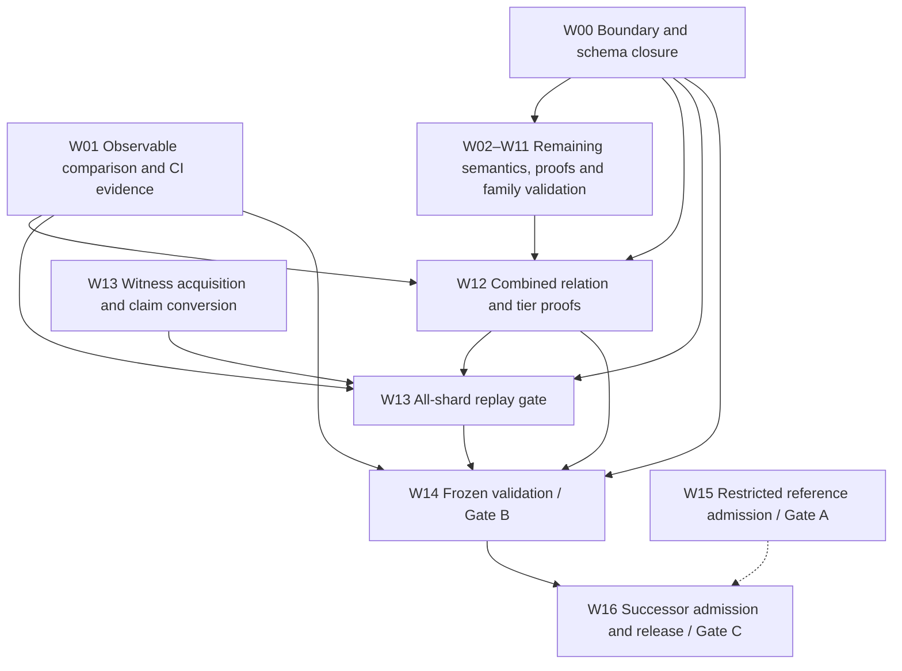

# Full Lean chunk transition — open work

Status as of 2026-10-26, main at `ad55805ea`. Target: nearcore 2.13.4
(`44f7ae6cd7ef08bab604e20a473bf77e35d4c993`), PV86, pinned mainnet runtime parameters.

This is the open backlog only. Measured results live in the evidence directories under
[`docs/evidence/lean-chunk-completion/`](../evidence/lean-chunk-completion/); the review narrative
that used to be here (CI repairs, the smoke-table fix, the signed-tier correction) is preserved in
[`workplan-review-2026-10-25.md`](../evidence/lean-chunk-completion/workplan-review-2026-10-25.md).
Package IDs are stable: a package stays listed while any criterion is open.

The [transition plan](LEAN_CHUNK_TRANSITION_PLAN.md) defines the gates:

- **Gate A:** restricted reference independently checked and admitted live with signed evidence.
- **Gate B:** one executable transition covers every reachable target case with protocol resource
  behaviour and complete validation; prover capacity must not exclude valid inputs.
- **Gate C:** full relation and tiers frozen, independently admitted, packaged and released.

All three are open. AIR/PQ implementation, GPU proving and succinctness are not prerequisites.
Nearcore correspondence is tested unless a refinement proof is supplied.

## Where the successor stands

All figures are for `nearspec-v3-check-successor --tier allFeatures` on one checker build
(`5c60547b3`, sha256 `29bf5217…`) unless stated.

| Evidence | Result |
|---|---|
| 27,270 code mutants (d3c7–d3c10) vs nearcore cold | 0 disagreements; 95 out of domain (preparation-pipeline race), all nearcore-rejected |
| 3,138-case gap census (nearcore ok ∧ `expected_rel_d3` false) | all accept |
| Corpus-wide **blind** replay, 39,942 non-mutant chunks: produced values removed from inputs, Lean's computed outputs compared to the nearcore header | 39,452 match all 11 fields, 0 mismatches; 266 genesis (outputs are a claim input), 224 `d2corpus.v2` chunks without code in the witness (cold verdict is `MissingTrieValue`) |
| Fixture sets from pinned nearcore: curve hosts, key families/gas keys, yield/resume, storage limits, real resharding splits, global cache, global promises | verdicts 111/111, 76/79, 202/202, 88/88, 38/38, 28/28, 3/3; every honest case blind-matches except 1 resharding case that cannot be blinded |
| Mainnet shard 13, 1,223 consecutive chunks | verdict 1,223/1,223, blind 1,223/1,223 |

Evidence: [corpus blind + pipeline](../evidence/lean-chunk-completion/corpus-blind-and-pipeline/README.md),
[shard 13 blind](../evidence/lean-chunk-completion/mainnet-w13-shard13-blind/README.md) and the
`*-fixtures/` directories.

## Decisions taken (2026-10-26)

- **Signed statement (UQ-010).** The secp256k1 delegate widening moved 37 signed-tier verdicts: 35
  `out_of_domain → accept` on the 3,138 census and 2 high-s `reject → accept`. Nearcore accepts all 37.
  They are **accepted as a strengthening** of the signed statement. The signed layer is not
  re-isolated.
- **ML-DSA-65 signatures** are to be implemented (FIPS 204 plus the `ml_dsa_65_verification_cost`
  term), not kept as a standing exclusion.
- **W13 all-shard replay** waits on a machine and disk the sponsor will provide. The current node
  tracks shard 13 only.

## Open work, by what blocks Gate B

| # | Package | Open | In progress (2026-10-26) |
|---|---|---|---|
| 1 | W02 | Arena/prover caps on successor tiers: `w.size` 4,000,000-byte bound has no lift; `c.segment` lift needs its full-corpus no-drift rerun; inventory of every other size/count cap against nearcore's own limits | caps lane |
| 2 | W02 | Evaluator fuel/termination: no proof that fuel suffices for valid metered execution | fuel lane |
| 3 | W06 | ML-DSA-65 signature verification + gas term; ML-DSA tx keys (`e.mldsa_tx`) and receipt signer keys (`oodMlDsaKey`); secp key with ED25519 signature (refused by `pTxD2Global`) | ML-DSA lane |
| 4 | W11 | Static V2 / PV85→PV86 splits (UQ-009); consecutive splits; threshold-driven gates; epoch-start validator update inside the walk; genesis segment with a layout change | resharding lane |
| 5 | W12/W10 | Tier monotonicity (`relSuccessor_*_mono`), successor–signed overlap, genesis/non-genesis overlap — all measured, none proved | proof lane |
| 6 | W01 | Refunds, return data, per-receipt outcomes, logs, writes and rollback are not emitted or compared directly (only through roots) | observables lane |
| 7 | W05/W07/W10 | No fixtures yet for: yields under congestion, curve hosts from callbacks, BLS writer register/OOB inputs, transaction-bearing genesis, target-side gas-key execution, rollback/refund composition | cross-family lane |
| 8 | W13 | 1,000-block all-shard window; cold native adapter (warm compiled cache used today); finality/authentication boundary | runbook in the D3 lane; capture waits on hardware |
| 9 | W08 | Historical/warm compiled-cache coherence; `completeCodeGlobal` rejects 86 valid warm-cache chunks; signed D3 tiers (`D3/FunctionCall.lean`) keep the pre-state code rule | — |
| 10 | W00 | 17 UQs and 28 inventory rows; fact authentication; versioned claim/witness schema | — |
| 11 | D3 | No kernel non-vacuity gate for D3 (`RealCaseD3` draft times out; see `docs/HANDOVER.md`) | D3 lane |
| 12 | W03 | `WasmUnknownError` / resource `LinkError` reachability (UQ-014) | — |
| 13 | W04 | Float overlap/range proofs, preparation negatives, composition | — |
| 14 | W09 | Recorder-link / upper-bound proof (UQ-015) | — |
| 15 | D1→D3 | `ZkFormal.PQ.Join.WitnessLift` existence (`Coverage.lean:191`) needs a real D2 witness producer; `ArmAgrees` is a hypothesis | — |
| 16 | W14–W16 | Frozen validation, Gate A admission, successor release | — |

Supporting research that is landed but carries no gate: the eleven `promise_*` encodings and the
`ripemd160` AIR row. Open for the AIR: `round_agrees`, the rotation bridge, feed-forward/digest rows
and the `X`-column message binding (see the review record).

## Dependency tree

Arrows are acceptance dependencies, not instructions to wait before coding.

W07/W08 share code-resolution and cache contracts; W07/W11 share obsolete-layout routing (UQ-006);
W09/W11 share trie accounting. W15's dashed edge means reusable admission tooling only.

## Acceptance requirements for outstanding work

Each remaining semantic change must satisfy transition-plan §5 and:

- Exercise executable successor paths through positive and discriminating negative whole chunks.
  Imports, standalone helpers and theorems that assume the missing result are insufficient.
- Bind pinned nearcore source, toolchains, parameters, oracle/checker binaries, inputs and outputs.
  Distinguish independent native outcomes from derived expectations and Python-reference evidence.
- Ground truth is pinned nearcore run cold. Produced values (roots, gas, receipts) are never inputs
  to Lean's computation; Lean computes them and they are compared (`--blind`).
- Cover each new branch/boundary with deliberate-breakage controls; at least 1,000 generated
  comparisons per new semantic family across at least four recorded seeds, plus directed tests.
- Compare computed roots, outcomes, gas/compute, refunds, logs, return data, receipts, writes and
  rollback. Missing results, crashes, timeouts and unsupported valid cases are not matches.
- A Lean accept of a nearcore-rejected chunk is a soundness bug. Nondeterminism in nearcore (thread
  races) is a named out-of-domain reason, never an accept.
- Build changed declarations and actual drivers; audit transitive axioms. Only `propext`,
  `Classical.choice` and `Quot.sound`; no `sorryAx`, semantic axioms or `native_decide`.
- Record package identity, counts/seeds, residual premises and remaining failures.

Shared checker, dispatch, codec, claim schema, root import and Lake target changes need one
integration owner. Preserve signed definitions and oracle pins (`make pin-check`). A semantic
correction invalidates affected evidence. Final whole-corpus replay is W14.

## Packages and success criteria

### W00 Boundary inventory and schema closure (L0 + integration)

Settle the canonical predicate, the remaining rejection guards, trusted facts and the 17 UQs in the
[inventory](../research/lean-chunk-coverage.md); finalize versioned claim/witness extensions and
boundary-fact contracts. **Success:** every open row/UQ has an owner, a source-backed disposition and
a test/proof obligation; nothing is relabelled complete to close Gate B.

### W01 Computed observables and CI validation (L7 + integration)

Header-level outputs are computed and compared (D1/D2/D3 out-drivers; successor `--emit`/`--blind`).
Open: per-receipt/transaction outcomes, refunds, return data, logs, writes and rollback compared
against nearcore; wrong-observable controls; the corpus-content CI gate on a provisioned runner.
**Success:** every required case has an asserted outcome and complete observable comparison.

### W02 Protocol capacity and evaluator totality (L1)

Open: fuel/termination sufficiency; the `w.size` bound and any other arena-only cap; the `c.segment`
no-drift rerun; below/at/above-limit stress with runtime/memory maxima for W16 budgets.
**Success:** no valid execution is rejected as fuel exhaustion or a prover-derived cap.

### W03 Remaining runtime-error semantics (Wasm owner + L7)

Resolve `WasmUnknownError` and resource `LinkError` reachability (including execution-slot retry
exhaustion) from pinned source. **Success:** no reachable environment failure is assumed absent or
renamed a domain exclusion.

### W04 Float proof and composition closure (L2)

Chunk-level old/new agreement on the overlap, arithmetic range/fuel obligations, preparation
negatives, cross-family composition. **Success:** proofs and composition checks pass; engine
agreement is not presented as an IEEE/nearcore refinement theorem.

### W05 Curve whole-chunk validation (L3)

Landed: all 12 alt_bn128/BLS hosts, `p256_verify`, `ecrecover` as whole chunks (111/111). Open:
register/OOB inputs for the remaining BLS writers; calls from callbacks/promise chains; post-NEP-488
`version = 1`. **Success:** every target curve host has whole-chunk parity evidence on every entry path.

### W06 Transaction and delegate key families (L3 key substream)

Landed: secp256k1 tx and delegate verification (with the high-s rule), ML-DSA-65 key handles,
whole-chunk key-family and gas-key fixtures. Open: ML-DSA-65 signatures and gas term, ML-DSA tx and
receipt signer keys, secp key with ED25519 signature. **Success:** every reachable key/signature
variant decodes and verifies on each entry path with trie parity.

### W07 Remaining actions and hosts (L4)

Landed: global actions, distribution receipts, promise hosts, gas-key promise hosts, yield/resume
fixtures. Open: target-side gas-key execution; obsolete-layout distribution routing (UQ-006, with
W11); mismatched distribution code identities (with W08); rollback/refund/emitted-receipt
composition. **Success:** every required promise/action shape executes on real tries with matching
fees, nonces, receipts and rollback.

### W08 Cache identity and environment closure (L1 + L4)

Landed: deploy-tracker resolution and the preparation-pipeline rule (`Successor/Pipeline.lean`).
Open: historical/warm compiled-cache coherence; `completeCodeGlobal`'s 86 valid-chunk rejects; the
pipeline rule in the signed D3 tiers; the cold native adapter for W13. **Success:** every code
resolution case is deterministic and justified, or rests on an authenticated input.

### W09 Storage boundary validation and bounds (L5)

Landed: one-byte nearcore flips of the per-receipt and chunk soft limits (3,098 verdicts, 0
disagreements). Open: the recorder-link/upper-bound proof (UQ-015); split and global-code
composition at the limit. **Success:** independent boundary evidence and observable parity validate
the accounting.

### W10 Genesis proof and fact closure (L6)

Open: non-genesis overlap proof; transaction-bearing genesis positives/negatives; genesis fact
authentication. **Success:** overlap theorem and transaction-bearing cases pass.

### W11 Resharding boundary validation (L6 resharding substream)

Landed: real dynamic splits (1,087 PV86 witnesses, 6 boundaries, both retention directions) with
`ReshardCore`/`TrieSplit`. Open: static V2 / PV85→PV86 splits (UQ-009) or a checked impossibility
argument; consecutive and threshold-driven splits; correctness/overlap proofs. **Success:** genuine
split fixtures match nearcore; no valid layout/split exclusion remains.

### W12 Full combined relation and tier proofs (integration + L1)

`allFeatures` is the candidate union; the named wide tiers are not cumulative and
`completeCodeGlobal` is not an ancestor. Open: tier inclusion/monotonicity and old-domain agreement
proofs; cross-family tests. **Success:** composition and proofs pass on a buildable package.

### W13 Authenticated mainnet witness replay (L7)

Landed: shard-13 diagnostic, blind. Open: the 1,000-block all-shard window (hardware pending); the
cold native adapter; the finality/authentication boundary. Use the
[replay gate](../../tools/mainnet-replay/README.md) and
[capture launcher](../../tools/mainnet-replay/nearcore-capture/README.md). **Success:** `make
w13-gate` reports 100% replay coverage, 100% verified matches and zero mismatches, unsupported
cases, missing witnesses or errors. `mismatch_percent` is `null` (N/A) with no comparisons.

### W14 Frozen validation and Gate B (L7 + integration)

Freeze one W12 package; replay D1 53,048, D2 67,384 and D3 115,284 cases plus every fixture set and
W13 on it; clean builds, axiom/runtime audits, resource measurements; one manifest binding code,
toolchains, parameters, commands, binaries, inputs and outputs. **Success:** the frozen package meets
every Gate B obligation.

### W15 Restricted reference admission / Gate A (L8)

Bind the exact restricted relation and trusted tree to artifact hashes, run the configured formal
checks and conformance, and archive signed live **ADMITTED at formal tier** evidence. Local or
unsigned PASS is insufficient.

### W16 Full successor admission and release / Gate C (L8 + integration)

Freeze the full relation, tiers, canonical encoding and fact provenance; pin the successor
challenge; obtain its own signed admission; demonstrate contributor instructions for another proof
system; authorized release. This workplan does not authorize external release.
