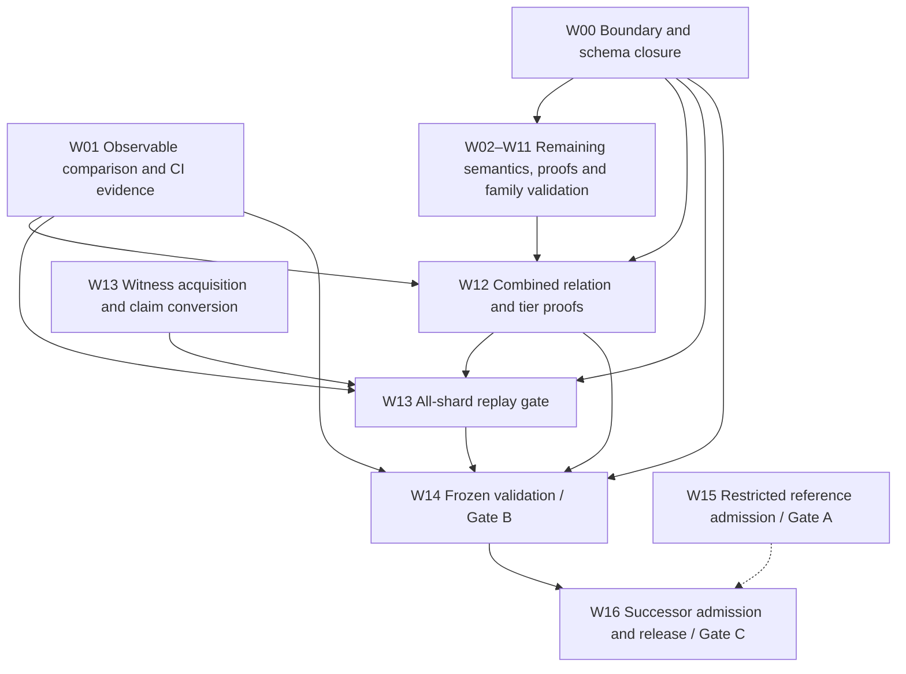

# Full Lean chunk transition — open work

Reviewed: 2026-10-25, against **main at `eff525719`** — six commits past `4ae27c76e`, the merge that
landed the W06 key widening and the 10-vs-13 base-arm repair — and CI run `40221939071` on that exact
commit. Every "verified" claim below was re-run on that commit or read out of that run; nothing here is
taken from a commit message. The six commits after `4ae27c76e` are documentation-only apart from the
honest `RipemdRound` header correction in `2466d7299`; the tree has no Lean or driver source change
between `8c6694412` and `eff525719`. The follow-up commit `56526dcb9` that lands this revision plus the
`.gitignore` rules below is also docs/ignore-only, so the build and driver figures still apply to the
current head. The earlier draft reviewed `a035df4a2` plus an
uncommitted widening tree; that tree is now merged, so "working tree" wording below means "landed on
main" wherever it describes the widening.
Target: nearcore 2.13.4, commit `44f7ae6cd7ef08bab604e20a473bf77e35d4c993`, PV86,
pinned mainnet runtime parameters.

This document lists remaining obligations; the status table records only what each package can
already build on, so open items are not re-done. Package IDs are stable: a package stays here
while any implementation, proof, validation or admission criterion is open. Detailed historical
results belong in lane logs and evidence directories, not this backlog.

**Re-verified on `eff525719` (measured, not copied from a commit message):** the source is unchanged
from `4ae27c76e` for every Lean and driver target, so the build results there still stand —
`lake build` in `spec/lean/v3` → 247 jobs green (246 before that commit; 247 after it adds
`NearSpecV3.Examples.SecpVerifyVector` to `defaultTargets` so the secp pin actually compiles);
`lake build` in `zk-formal` → 3,077 jobs green, 0 errors (both counts re-run on `eff525719` for this
revision; the wasm-base-lean count is 262 jobs, up from the 243 the lane log recorded at its merge);
`make d3-smoke` → exit 0; `make pin-check` → all `ok`; corpus-manifest schema → ok;
`python3 tools/d3/lean_chunk_coverage.py --repo . --nearcore <deps>/nearcore --check
docs/research/lean-chunk-coverage.json` → "matches pinned sources" (both path arguments are required;
the bare `--check` form exits on argument parsing);
`lake build WasmBase.RipemdVectors` → 18 jobs, "320 rows satisfy all 2625 constraints … RIPEMD-160
KATs ok"; the differential suite `pytest oracle/tools` → 86 passed / 1 skipped / 17 subtests; the
promise-encoding axiom audit → the four documented axiom closures; and the four breakage controls
below, each of which reproduces its documented failure count. The one claim in the previous draft
that did **not** reproduce is "the signed tier is bit-identical" — see the correction below.

**Re-run on `eff525719` for this revision:** `make d3-smoke` → exit 0, "SMOKE PASSED" (7 cases, 13
tiers, storage resolution, global actions, code-witness policy, float and runtime goldens); the global
block reports 28 accepted action chunks + 3 promise controls in both tiers with **2 key-widened chunks
decided by the successor and still excluded by the signed tier**, plus a host ablation that is detected;
`make pin-check` → all `ok`; coverage drift → "matches pinned sources"; corpus-manifest schema → ok.
CI run `40221939071` on `eff525719` is fully green: 16 passed / 0 failed / 2 skipped (corpus-content
gate without corpora, firecracker without KVM); the three jobs still in progress when this revision
started — "d3 successor drivers (build + smoke)", "formal-checker" and "rust" — all completed
`success`. Run `40218347295` on `8c6694412` and run `40214402787` (previously red only on the known
`fork_bomb` EAGAIN flake, green on attempt 2) are green as well — so no recent `main` run is red.
The [transition plan](LEAN_CHUNK_TRANSITION_PLAN.md) defines the authoritative gates:

- **Gate A:** restricted reference independently checked and admitted live with signed evidence.
- **Gate B:** one executable transition covers every reachable target case with protocol resource
  behaviour and complete validation; prover capacity must not exclude valid inputs.
- **Gate C:** full relation and tiers frozen, independently admitted, packaged and released.

All three gates remain open. AIR/PQ implementation, GPU proving and succinctness are not
prerequisites. Nearcore correspondence is tested unless a refinement proof is actually supplied;
candidate-to-Lean soundness and the stated checker/tier facts remain proof obligations.

## Status — done vs open (2026-10-25)

"Landed" means on main and reusable by the package; no package below is closed by it.

Measured gap set ([census](../evidence/lean-chunk-gap-census-2026-10-25.md) predicate: nearcore ok
∧ `expected_rel_d3` false, 3,138 cases) under `allFeatures`: **2,581 accept / 8 reject / 549
out-of-domain at `705ee41b5`** → **2,743 / 8 / 387** on the source committed with this table
(binary `3ad82706…`). The +162 are 73 gas-key promise hosts, 86 warm-cache pre-state contracts
served by the deploy tracker and 3 `c.segment` cases. The 387 were 266 ML-DSA-65 keys, 80
non-ED25519 transaction keys and 41 SECP256K1 delegate signatures; the 8 rejects are
`MissingTrieValue (contract code)` disagreements with recorded `nearcore(cold)` verdicts.
Same source: `lake build` 246 jobs, `make d3-drivers`, `make d3-smoke`, coverage drift check and
the differential harness reports 87 tests: 86 pass, 1 skipped.

**W06 key-substream widening measured on main at `4ae27c76e`: 3,130 accept / 8 reject / 0
out-of-domain.** All 387 closed — 266/266 ML-DSA-65 keys, 80/80 non-ED25519 transaction keys,
41/41 SECP256K1 delegate signatures — with zero regressions against the 2,743-accept baseline
(the 2,743 accepts and the 8 rejects are the same case set before and after; only the 387
out-of-domain rows moved, all to `accept`).

**Correction — the signed statement did move.** An earlier draft of this table claimed "zero
verdict drift on the `signed` tier … bit-identical before and after". That claim is **false** and has
been withdrawn. It was based on comparing two *post-widening* signed censuses against each other
(`census-signed-after.json` and `census-signed-final.json` are byte-identical, which proves nothing
about the widening); neither has a pre-widening counterpart. Re-measured against a real baseline — the
same 3,138 cases under `--tier signed` with the delegate SECP256K1 arm restored to the pre-widening
`throw`, rebuilt and re-run — the signed tier goes from **2,438 out-of-domain / 700 accept** to
**2,403 / 735**: **35 verdicts move `out_of_domain → accept`**, all 35 inside the 41-case SECP256K1
delegate set (6 of those 41 stay out-of-domain for unrelated reasons).

The population is reproducible without the two run JSONs: the 3,138 cases are exactly
`nearcore == "ok" ∧ expected_rel_d3 == false` over `d3c7`–`d3c10` (898 / 1,376 / 429 / 435 by corpus),
and both censuses contain exactly that set. Rebuild the reverted-arm binary, then run
`python3 tools/d3/replay_successor.py --tier signed --cases-file <list> --out <dir>` on the reverted
and the widened trees; the two `results.jsonl` files differ on exactly those 35 cases, all
`out_of_domain → accept` with the before-side reason
`out of domain (e.secp): SECP256K1 delegate signature verification`.

*Re-derived in this session from the two censuses* (`census-signed-before-full.json` and
`census-signed-widened-full.json`, both produced outside the repo and therefore not citable as paths):
the case sets are set-identical at 3,138 entries; the verdict tallies are 2,438 out-of-domain / 700
accept and 2,403 / 735; the diff is exactly 35 rows, all `out_of_domain → accept`, and all 35 carry the
single before-side reason above. So the 35-verdict figure is now reproduced from a stated population
rather than asserted — but the two JSONs themselves are untracked scratch files, so a clone still has
to regenerate them with the command above. The earlier "bit-identical" claim remains withdrawn: the two
byte-identical post-change censuses it rested on prove nothing.

The mechanism is not subtle, and it is why the "additive only" framing was wrong: `D2.actDelegate` is
*shared* by both layers. `checkD3` is `checkD2Core (d3Hooks …)`, and `checkD2Core` reaches
`applyAction … .delegate d => actDelegate …`, so replacing that arm's `throw "out of domain (e.secp)…"`
with `pure (Secp256k1.verify …)` widens the **signed** relation too. The signed exclusion list
(`Successor.lean:88`, ten features) never named `e.secp`, so nothing kept the signed layer's old
behaviour in place: the exclusion *was* the throw. The 35 moved cases are real signed-tier changes and
belong in the signed-statement review, not in a "successor only" column. Whether to accept them as a
strengthening or to re-isolate the signed layer behind its own decoder (`D2.pTxD2`-style, as the tx
key path already does with `pTxD2Global`) is an **open decision** — see the W06 row below.

Deliberate-breakage controls: dropping the
`near:ml-dsa-65-pubkey-hash:v1` domain tag from the key handle fails 73/266 ML-DSA cases on a
state-root mismatch; forcing the SECP256K1 tx check to `false` fails 34/80 tx-key cases; forcing the
delegate check to `false` fails 30/41 delegate cases — so all three wirings are load-bearing rather
than vacuously accepting. `Secp256k1.verify` is additionally pinned against an independent
`python-cryptography`/OpenSSL vector in `NearSpecV3/Examples/SecpVerifyVector.lean`
(`verify_accepts_known_good`), which the workplan's "Python reference only" note had left unchecked
in-tree.

### CI state, measured on the runs for the current head

`d3-smoke` is **not** a red CI job and has not been one on any recent run. The `d3 successor drivers
(build + smoke)` job passed on every measured run (`40116447922`, `40148396532`, `40166878067`,
`40172718660`, `40181642479`, and the runs cited below). The red jobs on the older runs are the ones
below; all are repaired.

**Resolved and confirmed in CI: run `40207431857` on the merged tree is fully green — 16 jobs passed,
0 failed, 2 skipped** (corpus-content gate without corpora, firecracker without KVM). Every previously
red job is green there: `rust`, `formal-checker`, `lean (zk-formal)`, `lean (research/near-compression/
wasm-base-lean)`, `lean (spec/lean/v3)` and `d3 successor drivers (build + smoke)`. So "fix d3-smoke"
is done and measured in CI, not only locally.

**Current head.** Run `40221939071` on `eff525719` finished fully green: 16 passed / 0 failed / 2
skipped, including the three jobs that were still `in_progress` when the previous revision was written
(`d3 successor drivers (build + smoke)`, `formal-checker`, `rust`). Run `40224660584` on `786270732`
(the revision that lands this text) is green on the same 16/0/2 split.

**One flake seen and cleared in this session.** Run `40224150896` on the docs-only commit `56526dcb9`
failed `rust (fmt, clippy, test, build)` at `make test-rust`, but that run was **cancelled** when the
next push superseded it, so no failed log was retained. The same suite passed in full locally
(`make test-rust` exit 0) and on the next two runs (`40224660584` and its retry chain), which is
consistent with the known `fork_bomb` EAGAIN flake already recorded — but it is *inferred*, not read
from a failed log. Treat "docs-only commits cannot fail rust" as unproven for this specific run.

The earlier run had 18 jobs: 15 ran and 3 were skipped (corpus-content gate without corpora,
firecracker and hostile-submission e2e without KVM). Four of the 15 failed, and all four are repaired;
each fix was verified locally first, then in run `40207431857`, not inferred from a commit message:

| Failing job | Cause | Repair (verified) |
|---|---|---|
| `rust (fmt, clippy, test, build)` | `umask_0077_trees_…` built its scratch dir under `deps()`, which does not exist on a hosted runner; `create_dir_all` failed with EACCES | `work_base()` falls back to the system temp dir when the deps tree is absent (`cargo test -p arena-firecracker --test umask` → 1 passed) |
| `lean (zk-formal)` | `Base` gained `deployGlobal`/`useGlobal`/`stateInit`, so `ZkFormal.PQ.Join.Fold.patchArm_eq_d3` and `.applyAction_congr` matched 10 constructors of 13, and `ZkFormal.PQ.Join.Coverage.patchArm_noncall` likewise. This is the *second* occurrence of the same 10-vs-13 bug: `RunCallFold` was fixed first, and the same three arms were missed in `Fold`/`Coverage` | three `rfl` arms added in `Fold` and three in `Coverage`; `applyAction_congr`'s `rcases` widened to 13 alternatives (`lake build` → 3,077 jobs green, 0 errors) |
| `lean (research/near-compression/wasm-base-lean)` | `RipemdVectors.lean` wrote a diagnostic to `/tmp/opencode/ripemd_diag.txt`, which is absent on CI | diagnostic write removed; the differential still runs and still fails the build on mismatch (`lake build WasmBase.RipemdVectors` → 18 jobs, "320 rows satisfy all 2625 constraints … RIPEMD-160 KATs ok") |
| `formal-checker (corpus, native csimp, NEAR spec)` | `near-chunk-v3.json`'s trusted import closure omitted 9 modules that the changed sources now import | nine modules added to the challenge closure (`cargo test -p arena-formal-checker --lib` → 16 passed) |

`d3-drivers` itself passed on that push at five cases, so the seven-case widening is a strengthening,
not a repair: it makes each widening driver answer for its own family instead of only being executed.

### `make d3-smoke` was red locally, not in CI — the stale exclusion table (fixed)

CI's smoke job was green because CI ran the committed sources. The target was red on the pre-merge
working tree that carried the W06 key widening, and the cause was `tools/d3/smoke_successor.py`, not a
spec regression: its global-action block hard-coded two "key exclusion" expectations left over from
before the widening. Fixed, landed in `4ae27c76e`, and green locally and in CI run `40207431857`.

```
AssertionError: {'case': '.../global-cache-fixtures/cases/00-h10011-s0',
                 'reason': '', 'tier': 'globalActions', 'verdict': 'accept'}
```

The table asserted `00-h10011-s0` → `out of domain (w.shape): non-ED25519 transaction key` and
`00-h10021-s2` → `out of domain (w.shape): ML-DSA-65 public key`. Both now decode and **accept**,
because the widening implements what those exclusions stood for:

- `TxD2.sigTag` keeps the outer signature discriminant and `TxD2.sigOk` dispatches on it, so a
  SECP256K1 transaction key is verified with `Secp256k1.verify` instead of rejected
  (`00-h10011-s0` carries `ood_secp256k1_multi`).
- `PublicKey.handle` maps an ML-DSA-65 key (tag 2) to the 32-byte `SHA3-256("near:ml-dsa-65-pubkey-
  hash:v1" ‖ key)` handle under tag 3, so a 1,952-byte key never lands in state and the case's
  access-key lookups resolve (`00-h10021-s2`).

Measured, not assumed: all 28 global-cache fixtures plus the 3 promise controls accept in **both**
`globalActions` and `completeCodeGlobal`, and all 28 record `nearcore = ok`, so accepting them agrees
with nearcore rather than loosening the relation. Tampering each fixture's claim or witness is still
rejected (`invalid: chunk slots do not match chunk_headers_root` / `decode: truncated
predecessor_id` for `00-h10011-s0`; `invalid: segment is not hash-linked` / `invalid: receipt proof
merkle path` for `00-h10021-s2`), so the accepts are load-bearing.

The repair keeps the split the table was trying to express instead of deleting the check: successor
tiers must **accept** both fixtures, and the `signed` tier must still **exclude** them — so "dropping
the widening" and "leaking the widening into the signed statement" both fail the smoke. The `signed`
tier currently reaches an earlier exclusion on these fixtures (`GlobalContractDistribution receipt`,
verified per case), so the assertion is on the verdict split, not on which exclusion fires first. Note
the limit of that guard: these two fixtures are excluded by a *different* feature, so the smoke does
**not** catch the delegate-arm leak measured above — that leak shows up only on the 41 SECP256K1
delegate cases. `make d3-smoke` is green end to end: 7-case fixture, 13 tiers, storage resolution,
global actions, code-witness policy, float goldens, runtime golden.

Two guard failures were also checked deliberately: removing the source stamp or corrupting it makes
`run_smoke.py` exit 1 with a "binaries are stale" message rather than reporting a green result against
old binaries.

### The two key-widened fixtures are settled, not merely excluded

An earlier revision left two questions open about the fixtures the stale exclusion table named. Both
are now measured on the current head, and both resolve in favour of "accept, with no transition
disagreement":

- **`00-h10011-s0` does not reject with "invalid: main transition post state root".** Run across all
  twelve tiers — `signed`, `runtimeLimits`, `globalActions`, `completeCodeGlobal`, `curveHosts`,
  `resharding`, `allFeatures`, `genesis`, `genesisFloatsProtoGas`, `floats`, `protoGas`,
  `storageResolution` — it returns `accept` with an empty reason on **every** tier. So the earlier
  "once the secp256k1 exclusion is lifted it rejects with a main-transition-post-state-root mismatch"
  observation does not reproduce on this tree: there is no genuine transition disagreement to chase
  and no exclusion to restore for that reason. (The rejection text still exists in the codebase —
  `ChunkValidationD1.lean:161`, `ChunkValidationD2.lean:242`, `ChunkValidationV0.lean:204`,
  `GenesisD3.lean:374` — but this fixture never reaches it.)
- **`00-h10021-s2`'s ML-DSA-65 exclusion entry needs no replacement.** Same sweep, same result:
  `accept` on all twelve tiers. The `PublicKey.handle` widening (§ above) resolves its access-key
  lookups, so nothing about the ML-DSA key blocks it.

Both remain load-bearing under tampering, re-measured in this session on a copy of each fixture: flipping
one byte mid-`claim.bin` turns `00-h10011-s0` into `reject` / `invalid: chunk slots do not match
chunk_headers_root` and `00-h10021-s2` into `reject` / `invalid: segment is not hash-linked`. So the
accepts are not vacuous — the earlier text's two tamper reasons reproduce.

The *smoke-level* split is separate and still holds: on the **global-cache fixture copies** the signed
tier excludes both at `GlobalContractDistribution receipt` while `globalActions`/`completeCodeGlobal`
accept. The d3c9 corpus copies of the same names accept everywhere, including `signed` — different
bytes, different case. Do not read the d3c9 result as the fixture result or vice versa.

### Remaining open work — prioritized

The package table above is the authoritative per-package backlog. In descending order of what
actually blocks the three gates:

1. **W12 / Gate B — prover-derived bounds.** `c.segment` is lifted on `allFeatures` only and needs a
   full-corpus rerun proving it changes no other verdict. The `w.size` 4,000,000-byte storage-proof
   bound (`ChunkValidationD2.lean:236`, `Successor/RuntimeCore.lean:55`) has **no lift at all**; it
   shows zero failures today only because no corpus case reaches it. Gate B forbids both.
2. **W06 — key families.** The 387-case exclusion block is closed on the widening tree (266 ML-DSA-65
   keys, 80 non-ED25519 transaction keys, 41 SECP256K1 delegate signatures), so what remains is the
   part the widening deliberately does not admit: **ML-DSA-65 signatures** (FIPS-204 verification plus
   the `ml_dsa_65_verification_cost` burnt-gas term) and ML-DSA transaction keys/signatures, still
   excluded as `e.mldsa_tx`. The newly wired secp paths are covered by Python-reference vectors but not
   yet by pinned-nearcore whole-chunk replay. Nothing in this package is a Gate-B exclusion any more;
   it is a proof/evidence gap.
   *Open decision from the corrected measurement above:* the SECP256K1 delegate widening moved **35
   signed-tier verdicts** `out_of_domain → accept` (2,438/700 → 2,403/735), because `actDelegate` is
   shared with `checkD3` and the `e.secp` exclusion *was* the throw, not an entry in
   `signedExclusions`. So the signed statement is **not** unchanged — and this change is now **on
   main** as `4ae27c76e`, so the decision is retroactive rather than pre-merge. Two options:
   (a) accept the 35 as a signed-statement strengthening and record the change against UQ-010's
   "named statement of record", or (b) re-isolate the signed layer behind its own decoder so the
   widening stays successor-only — the pattern the tx-key path already uses (`D2.pTxD2` excludes,
   `pTxD2Global` admits), and which the action codecs already model as `D2.pBase`/`pBaseAct` vs
   `Successor.pBaseGlobal`/`pBaseActGlobal`. Option (b) therefore means splitting `actDelegate` the
   same way (a signed variant that throws on the secp pair, a successor variant that verifies) and
   threading it through `applyAction`'s hook rather than editing the shared arm. Option (a) is the
   honest description of what main does today; option (b) is what the "additive only" claim assumed.
   This stays open and is **not** closed by the green CI run: CI proves the code builds and the
   drivers agree, not that `checkD3`'s meaning should have changed.
3. **W08 — the 8 `MissingTrieValue` disagreements.** Lean rejects 8 mutants whose recorded
   `nearcore(cold)` verdict accepts. These are disagreements, not exclusions, and they need a base/
   mutant witness diff at the code lookup, not a tier change. Separately,
   `completeCodeGlobal` rejects 86 nearcore-valid warm-cache chunks, so it is not an ancestor of
   `allFeatures` in the accept direction.
4. **W02 — fuel and termination.** No proof that evaluator fuel suffices for valid metered execution.
5. **W13 — all-shard replay.** The shard-13 diagnostic (1,223 chunks, 0% mismatch) is not the
  1,000-block all-shard gate, and the cold native adapter is still unimplemented.
6. **The D1→D3 witness lift — unproved, and not owned by any package row.** It is the `def`
   `ZkFormal.PQ.Join.WitnessLift` *in* `ZkFormal/PQ/Join/Coverage.lean:191` (there is no separate
   `WitnessLift.lean` module), and `Coverage.lean` states it as the existential it must be:
   `WitnessLift B cb w := RelD1a B cb w → ∃ w2, RelD3 cb w2`, consumed by `relD3_of_lift`, whose
   conclusion carries the extra `StateSide … w2 sa` conjunct so it cannot be discharged by
   `hlift hrel` alone. The *existence* is open: `RelD1a`'s decoders reject every non-Transfer action
   (`TxD1.lean:97`), every non-Transfer receipt (`NearSpec/Codec.lean:75`) and any code blob
   (`ChunkValidationD1.lean:63`), so a D1 witness has no `FunctionCall` to cover, while `RelD3` is
   checked on the D2 witness format. Closing it needs a real D2 witness *producer* whose state
   witness has the D3 shape — not a re-reading of the same bytes. `ArmAgrees` is likewise a
   hypothesis: it equates the D1 state tables' answer with the Wasm machine's outcome and needs both
   artifacts, which `zk-formal` does not import. No D2 or D3 AIR exists to port against.
7. **W00 — 17 UQs and 28 inventory rows** stay open and Gate-B-blocking; W14–W16 depend on them.
8. **The AIR/supporting-research family — landed but not gate-load-bearing.** Nothing below blocks a
   gate today, which is exactly why it is easy to lose. Each is a named gap in its source file, not an
   unstated defect:
   - **RIPEMD `round_agrees` is unproved.** `WasmBase/RipemdRound.lean` has the machinery and **zero**
     per-word instance theorems; the eight wiring-only words follow only in prose from
     `nxtWord_eq_cur` + `RipemdAir.shiftConstraints`. `bl'`/`br'` need the four-addition chain composed
     with the `f` column, the selected message word and the rotated `t3`. A general rotation bridge is
     also absent (`rotl32n_is_rot` is a `decide` over 80 offsets × 8 values).
   - **The feed-forward row family and the block-boundary/digest rows** are absent from `RipemdAir`, so
     the row cannot yet be consumed by a host call.
   - **The `X`-column message-word binding** — that the 512 message columns are the block's bytes at the
     call's `(ptr, len)` — is the same `HOSTB`/memory ↔ bytes join obligation `Sha.HashInputLink`
     carries. The `X` columns carry no interaction, so the AIR's own constraints cannot close it.
   - **Promise-family coarseness.** `promise_yield_resume*` pushes an `i32` result tag 0 while the chip's
     result tag is fixed at 1 (`results/pq-host-promise/DESIGN.md` §3).

Two supporting-research results are landed but not yet load-bearing for any gate, and should not be
mistaken for package closure:

- **The eleven `promise_*` encodings** (`bdf80d018`, `ZkFormal/PQ/Receipt/Receipt.lean` §7) encode the
  receipt body as one field list and close `promise_encodings_cover`,
  `promise_encodings_cover_discriminates`, `receiptCreators_are_six` and `remaining_eleven_closed`.
  Axiom audit: the first two depend on no axioms; `promise_encodings_cover_discriminates` uses
  `[propext]`; `remaining_eleven_closed` uses `[propext, Quot.sound]`. "Axioms: none" holds only for
  the first two. Coverage is keyed by action kind and receipt shape, not host id;
  `promise_set_refund_to` (id 13) is the lone `rtOnlyIds` exception. The promise family remains
  coarse on one point: `promise_yield_resume*` pushes an i32 result tag 0 against the chip's fixed
  tag 1 (`results/pq-host-promise/DESIGN.md` §3).
- **The `ripemd160` AIR row** (`f7b1a6e0c`, `WasmBase/RipemdAir.lean`, 1,608 columns / 2,625
  constraints; `WasmBase/RipemdVectors.lean`) is differentially tested: 320 rows satisfy all 2,625
  constraints, 17 tampers are rejected, 13 digests match the spec, and the RIPEMD-160 KATs pass.
  Cost is **128,640 committed cells per block** (1,608 × 80), 13.8× SHA-256's 9,333; the earlier
  "≈9–11 k" figure was wrong and is retracted. Four obligations remain open and the two source files
  state them: `round_agrees` itself (the two computed next words `bl'`/`br'` need the four-addition
  chain composed with the `f` column, selected message word and rotated `t3`), the general rotation
  bridge (`rotl32n_is_rot` is only a `decide` over 80 offsets × 8 values, not a proof for arbitrary
  `v`), the feed-forward row family plus the block-boundary/digest rows (both absent from
  `RipemdAir`), and the `X`-column message-word binding — that the 512 message columns are the
  block's bytes at the call's `(ptr, len)`. The `X` columns carry no interaction at all, so this is
  the same stated join obligation `Sha.HashInputLink` carries (`HOSTB`/memory ↔ bytes) and needs the
  same kind of link proof; it is *not* closed by the AIR's own constraints. The AIR proves "digest
  follows from message columns"; two message columns are still free, which is a named gap, not a
  fix. No gate depends on this AIR.
  *Correction to an earlier count:* the earlier "8 of the 10 next words exist" wording overstates the
  file. `RipemdRound.lean` has **zero** per-word instance theorems; what exists is the generic
  `nxtWord_eq_cur` (per-bit shift → word identity) plus the AIR's ten shift constraints
  (`RipemdAir.shiftConstraints`), from which the eight wiring-only words follow — but that reduction is
  stated in prose, not written as eight lemmas. Only `bl'`/`br'` need arithmetic; the eight are
  "immediate" in the sense that no adder chain is involved, not in the sense of being proved.

### Working-tree state at `eff525719` — five untracked paths, now decided

`main` at `eff525719` carried five untracked paths. Each was inspected and given a disposition rather
than left dangling; the first two are now ignored by name in `.gitignore` with the reason beside them:

| path | size / shape | disposition |
|---|---|---|
| `req.log` | 1.7 KB, chain-generator stdout from 2026-10-20 | gitignored — regenerable scratch output, no provenance value |
| `research/near-compression/results/pq-realtime-hypothesis/` | 112 MB, 943 top-level entries / 1,106 files (prover benchmark packets, `.bin` witnesses, endpoint JSON) | gitignored — **no file in the tree or in any doc cites a path under it**, so committing it would add 112 MB of unreferenced blobs; keep it locally |
| `spec/lean/scripts/gen_realcase_d3.py` | 3.8 KB generator | gitignored with the draft below — it only exists to emit them |
| `spec/lean/v3/NearSpecV3/Examples/RealCaseD3.lean` | 799 B, one `decide +kernel` theorem | gitignored — the theorem does not close (four SIGTERM timeouts at 1,800–3,000 s, zero output); do not land as evidence |
| `spec/lean/v3/NearSpecV3/Examples/RealCaseD3Data.lean` | 27.8 KB, two byte literals (5,267 B claim / 6,023 B witness) | gitignored with its theorem |

The D3 kernel non-vacuity gap this represents stays open and is **not** hidden by ignoring the draft:
the analogue of D2's `RealCaseD2` gate still does not exist, and `spec/near-chunk-validation-d3.md` has
no kernel non-vacuity bullet. See `docs/HANDOVER.md` "No kernel non-vacuity gate for D3" for the two
separated failure modes and the structural fix (making `RelD3` Bool-primary needs a versioned
successor).

| Package | Landed on main | Still open (headline) |
|---|---|---|
| W00 | Successor interfaces (7 contracts) and owner map for all 28 open rows / 17 UQs (`be3ebbca8`); `checkD3`/`RelD3` named statement of record (UQ-010) | All 17 UQs; fact authentication; versioned schema |
| W01 | CI split into schema / corpus-content / `d3-drivers` jobs; 1,259 unasserted exclusions asserted; comparator compares widened `e.code_cache` cases against nearcore; smoke fixture widened to seven cases so each of the four drivers is compared against its **own** declared expectation domain (baseline as `domain=baseline`; d3f/d3g/d3proto as `domain=successor` with the family each lifts), with a per-driver controlled breakage; **computed outputs emitted** by the D1/D2/D3 out-drivers (`work/lean-chunk-full` merge: 115,284 cases, 0 field mismatches; 1,440 header mutants) and by the successor (`--emit`/`--blind`, `checkD2CoreWithObs`) | Refunds, return data, per-receipt bodies, writes and rollback are not emitted; corpus gate on a provisioned runner |
| W02 | `protoGas` tier and `checkD3Proto` driver (846 band chunks); opt-in `segmentUnbounded` lifts `c.segment` on `allFeatures` only (signed unchanged) | Full-corpus proof the lift changes no other verdict; `w.size` 4 MB bound; fuel/termination; checker/overlap/tier proofs; stress |
| W03 | — | Everything listed |
| W04 | Float tiers with 2,050 operator / 1,284 chunk / 350 mutant comparisons | Overlap/range proofs; preparation negatives; composition |
| W05 | Curve host code and `curveHosts` tier (`5bf2ee8f4`); three alt_bn128 rows moved missing→partial | Whole-chunk parity for every curve host, p256 |
| W06 | `Secp256k1.recover` (161 nearcore vectors); `Secp256k1.verify` (ECDSA) and `Wasm.Crypto.sha3_256`, checked against Python references (24 ECDSA vectors, 5 FIPS-202 digests). On the widening tree (`4ae27c76e`) verify is **called** by the delegate arm (`actDelegate`/`actDelegateL`) and the transaction path (`TxD2.sigOk` dispatching on `TxD2.sigTag`), and ML-DSA-65 keys are admitted in key-storage positions (`pPkGlobal`, `pBaseGlobalKeyed`) with the `SHA3-256` handle in `PublicKey.handle`. **Not successor-only:** because `actDelegate` is shared, the delegate arm moved 35 `signed`-tier verdicts `out_of_domain → accept` (measured against a reverted-arm rebuild), so the signed statement changed | ML-DSA-65 **signatures** (verification + the `ml_dsa_65_verification_cost` burnt-gas term, `85.yaml:15`, `runtime/src/config.rs:660-690`); ML-DSA tx keys/signatures stay excluded as `e.mldsa_tx`; nearcore whole-chunk vectors for the newly wired secp paths; decide whether the 35 signed-tier moves are accepted or the signed layer is re-isolated (see item 2 above) |
| W07 | Global actions, distribution receipts and 10 promise hosts incl. gas-key lift (`628551b85`); 72/72 gas-key gap cases accept | Pinned-nearcore gas-key whole-chunk replay; target-side gas-key execution; obsolete-layout routing (UQ-006) |
| W08 | `completeCodeGlobal` policy; cold-partial resolution consults the deploy tracker before trie (`ContractStorage::get` order), so only rolled-back deploys stay cache-excluded | The 8 `MissingTrieValue` disagreements; historical cache coherence; `completeCodeGlobal` rejects 86 valid chunks |
| W09 | `storageResolution` tier | Independent exact-limit fixtures and bounds |
| W10 | Genesis checker soundness fix: 137 genesis accepts, zero non-genesis changes | Overlap proof; transaction-bearing genesis cases; fact authentication |
| W11 | Resharding semantics and `resharding` tier (`4d264c005`); Layout driver repair. **Real dynamic-resharding split fixtures** (`reshard` generator, [evidence](../evidence/lean-chunk-completion/resharding-fixtures/README.md)): 1,087 PV86 witnesses across 6 split boundaries (both retention directions, missing parent/child chunks, buffered/delayed/outgoing receipts, forced split gates), all accepted by `allFeatures`; blind 1,084/1,087 with no field mismatch (3 harness errors); 86/86 split, layout and gate mutants rejected. Lean: cross-layout walk (`ReshardCore`), squashing split trie, child congestion, receipt reassignment, `find_trie_split` gate, V3 bandwidth/forwarding | Static (V2, PV85→PV86) splits; consecutive splits; threshold-driven gates; fact authentication; correctness/overlap proofs |
| W12 | `allFeatures` tier: config-level theorems that it sets every wide tier's features, that the named wide tiers are not cumulative and that `completeCodeGlobal` is not in the join; rank order corrected | Semantic composition/refinement proofs (`relSuccessor_*_mono`); cross-family tests |
| W13 | Shard-13 diagnostic rerun on committed source: 1,223 consecutive chunks, verdict 1,223/1,223 and **blind** 1,223/1,223 — Lean computes state/outcome/outgoing roots, gas used, balance burnt, congestion, bandwidth, proposals and encoding from inputs with those values removed, compared against the canonical chunk header ([evidence](../evidence/lean-chunk-completion/mainnet-w13-shard13-blind/README.md)); capture runbook and payload stats | All shards; a window with proposals, bandwidth requests, congestion and missing chunks; cold native adapter (warm compiled cache used); finality/authentication |
| W14–W16 | — | Everything listed |

## Dependency tree for parallel work

Arrows are acceptance dependencies, not instructions to wait before coding. W13 acquisition and
W15 admission auditing can proceed alongside semantic work. W12 integrates increments continuously.



| Package | Owner | Remaining focus | Close after |
|---|---|---|---|
| W00 | L0 + integration | Boundary questions, canonical predicate, fact/schema authentication | None |
| W01 | L7 + integration | Computed observables and actual CI/frozen-driver coverage | None |
| W02 | L1 | Fuel, resource limits, capacity and overlap proofs | W00 |
| W03 | Wasm owner + L7 | Remaining runtime-error/environment reachability | W00 |
| W04 | L2 | Float overlap/range proofs, preparation negatives, composition | W00 |
| W05 | L3 | Remaining curve whole-chunk coverage and parity | W00 |
| W06 | L3 key substream | secp256k1 and ML-DSA transaction/delegate keys | W00 |
| W07 | L4 | Gas-key translation, obsolete-layout distribution and composition | W00 |
| W08 | L1 + L4 | Cache identity/environment closure and broader code-policy validation | W00 |
| W09 | L5 | Independent exact-limit fixtures, observable parity and resource bounds | W00 |
| W10 | L6 | Non-genesis overlap, transaction-flag negatives, fact authentication | W00 |
| W11 | L6 resharding | Real split fixtures, mixed-protocol reachability and validation | W00 |
| W12 | Integration + L1 | Full composition, tier/overlap proofs and cross-family tests | W00–W11 |
| W13 | L7 | Executable authenticated all-shard mainnet replay | W00, W01, W12 |
| W14 | L7 + integration | Frozen full-package validation and Gate B evidence | W00, W01, W12, W13 |
| W15 | L8 | Exact restricted-reference live formal-tier admission | None |
| W16 | L8 + integration | Full successor admission and authorized release | W14 |

W07/W08 share code-resolution and cache contracts; W07/W11 share obsolete-layout routing;
W09/W11 share trie accounting. Settle shared contracts in W00 without serializing entire packages.
W06 can reuse secp arithmetic independently of W05's remaining validation. W15's dashed edge
means reusable admission tooling, not a prerequisite: W16 needs the successor's own admission.

## Acceptance requirements for outstanding work

Each remaining semantic change must satisfy transition-plan §5 and these requirements:

- Exercise executable successor paths through positive and discriminating negative whole chunks.
  Imports, standalone helpers and theorems assuming the missing semantic result are insufficient.
- Bind pinned nearcore source, toolchains, parameters, oracle/checker binaries, inputs and outputs.
  Distinguish independent native outcomes from derived expectations and Python-reference evidence.
- Cover each new branch/boundary, with deliberate-breakage controls; at least 1,000 generated
  comparisons per new semantic family across at least four recorded seeds, plus directed tests.
  Existing qualifying evidence need not be regenerated until semantic changes or freeze require it.
- Compare computed roots, outcomes, gas/compute, refunds, logs, return data, receipts, writes and
  rollback. Missing results, crashes, timeouts and unsupported valid cases cannot count as matches.
- Build changed declarations and actual drivers; audit transitive theorem axioms and runtime paths.
  Only `propext`, `Classical.choice` and `Quot.sound` are allowed logical axioms; no `sorryAx`,
  semantic axioms, verifier-result oracles or native shortcuts.
- Record exact package identity, counts/seeds, residual premises and remaining failures. Validate
  inventory rows only for the executable paths actually tested.

Shared checker, dispatch, codec, claim schema, root import and Lake target changes require one
integration owner. Preserve signed definitions and oracle pins. Do not rebuild an executable during
replay; a semantic correction invalidates affected evidence. Final whole-corpus replay is W14.

## Open packages and success criteria

### W00 Boundary inventory and schema closure

Owner: L0 + integration.

- Settle the canonical predicate and any mismatch between `Wasm.DomainD3` and actual dispatch.
  Reconcile remaining rejection guards, trusted facts, key-family rows and unresolved questions in
  the [inventory](../research/lean-chunk-coverage.md).
- Close cache/environment assumptions, activation/mixed-epoch segments, size limits, gas schedules,
  resharding witness representation and external-fact authentication. Treat `unmodeled` paths as
  proof/test obligations until justified unreachable for valid prepared inputs.
- Finalize versioned claim/witness extensions and concrete boundary-fact contracts. Computed
  transition outcomes must not be supplied as trusted substitutes for execution.
- Complete interface/semantic contracts for remaining integrations; reconcile inventory status and
  evidence against the resulting source, with unique IDs and a passing generator drift check.

Success: every open row/UQ has an owner, source-backed disposition and test/proof obligation;
no unresolved boundary assumption is relabelled complete to close Gate B.

### W01 Computed observables and CI validation

Owner: L7 + integration.

- Emit per-case **computed** roots, outcomes, gas/compute, refunds, logs, return data, receipts,
  writes and rollback from the Lean driver; compare with independent expected results. Header-level
  outputs are emitted and compared (out-drivers; successor `--emit`/`--blind`); refunds, return
  data, per-receipt bodies, writes and rollback are still only covered through the roots.
- Add wrong-observable controls alongside existing process/verdict controls. Ensure final combined
  outputs and manifests bind every input and actual driver, including all remaining configurations.
- Obtain evidence that the pinned-corpus content gate actually runs on a provisioned runner;
  schema-only checks are not corpus-content validation.
- Exercise CI builds/tests for the final required successor modules and drivers, including the
  remaining key and real resharding paths; a YAML command alone is not execution evidence.
  The smoke fixture now carries seven cases and compares every driver against its own declared
  domain (`baseline` or `successor` with an explicit `widen` set), so "the driver ran" is no longer
  sufficient: a driver that stops widening, widens wrongly or returns a wrong verdict fails. That
  closes the "merely executed the other three drivers" gap for the four D3 binaries, but it is still
  seven cases, not the corpus sweep.

Success: every required case has an asserted outcome and complete observable comparison;
missing/wrong results fail; clean-run CI and package identities support W12–W14.

### W02 Protocol capacity and evaluator totality

Owner: L1.

- Prove evaluator fuel/termination suffices for valid metered execution, including all finite
  allowances and protocol-scale stack/memory use, or replace the evaluator strategy accordingly.
- Remove or justify arena-only 32-block segment and claim/witness-size limits. Versioned encodings
  must represent every valid target case; candidate budgets remain separate from validity.
  The `c.segment` lift is landed on `allFeatures` only; establish on a full-corpus rerun that it
  changes no other verdict. The `w.size` 4,000,000-byte storage-proof bound (`ChunkValidationD2.lean:236`,
  `Successor/RuntimeCore.lean:55`) is the same prover-derived class and has no lift yet, though no
  corpus case currently exceeds it.
- Complete below/at/above protocol-limit, overflow and out-of-gas stress comparisons; record maximum
  runtime/memory and scaling for W16 budgets.
- Prove whole-checker characterization, declared overlap agreement and tier inclusion/nesting with
  exact premises. Sampled agreement is not a proof.

Success: no valid supported execution is rejected as fuel exhaustion or a prover-derived cap.

### W03 Remaining runtime-error semantics

Owner: Wasm owner + L7.

- Resolve `WasmUnknownError` and remaining resource `LinkError` reachability with pinned-source
  arguments and tests. In particular, execution-slot retry exhaustion can yield a charged
  `LinkError`; specify/model its environment input or justify its exclusion at the target boundary.
- Define every required scheduler/concurrency/runtime-environment assumption precisely. Failure to
  construct a reproducer is not an impossibility argument.
- Validate remaining branches and phase ordering through the final combined checker, comparing
  error kind, gas, state and rollback and adding targeted breakage controls.

Success: no reachable environment failure is silently assumed absent or renamed a domain exclusion.

### W04 Float proof and composition closure

Owner: L2.

- Complete chunk-level old/new agreement on the declared overlap and formal arithmetic range/fuel
  obligations beyond existing guard lemmas and source reasoning.
- Add outstanding preparation negatives, with correct phase, gas and rollback through chunks.
- Complete full-observable and cross-family validation with crypto, global actions, genesis,
  storage accounting and other applicable successor paths under W12.

Success: remaining proofs and preparation/composition checks pass; engine agreement is not
presented as a formal IEEE/nearcore refinement theorem.

### W05 Curve whole-chunk validation

Owner: L3; coordinate with the existing curve agent.

- Generate positive and negative accepted-checker chunks for every curve entry path still lacking
  such evidence, especially all alt_bn128 and BLS hosts; establish p256 whole-chunk coverage too.
- Compare pinned gas/charge order, memory/register access, return values, state and failure kinds:
  malformed lengths/encodings, noncanonical scalars, subgroup/infinity and PV86 quirks.
- Complete independent generated family comparisons and deliberate-breakage controls where the
  package-wide acceptance contract is not yet satisfied; validate final cross-family composition.

Success: every target curve host has independent whole-chunk parity evidence. Arithmetic vectors
and reachable dispatch alone do not close the package. W06 key verification is separate.

### W06 Transaction and delegate key families

Owner: L3 key substream.

- Implement secp256k1 transaction/delegate verification, distinct from ecrecover. On the widening
  tree (`4ae27c76e`) this is **wired**, not merely landed: `Secp256k1.verify` (ECDSA over the existing
  arithmetic) is called at `D2.actDelegate` / `Logged.actDelegateL` (tag pair `1,1`) and at the new
  `TxD2.sigOk` dispatch consumed by `TxD2.valid`, and is admitted by the successor decoders
  `pTxD2Global` (outer signature tag 1, 65-byte `r ‖ s ‖ rec_id`) and `pBaseGlobalKeyed` (key
  positions). It is pinned against an independent OpenSSL vector in
  `NearSpecV3/Examples/SecpVerifyVector.lean` (`verify_accepts_known_good`, a `decide +kernel`
  evaluation), and this tree adds that module to `defaultTargets` so the pin compiles in the default
  build instead of sitting unbuilt next to it — the previous draft cited it as in-tree evidence while
  nothing compiled it. Still open: nearcore's own signing vectors as
  whole-chunk fixtures (the current pin is a unit vector, not a replayed chunk), and `TxD1.lean`'s
  path, which still rejects non-ED25519 keys by design so the signed statement does not move.
- Implement ML-DSA-65 key/signature codecs, executable verification, key handles and trie integration,
  including the pinned SHA3-based public-key handle where required. Only `Wasm.Crypto.sha3_256`
  exists (matches FIPS 202 on Python-reference digests); update the stale exclusion text at
  `D2/Types.lean:20` ("SHA3-256 … not formalized") when the handle is wired.
  *Done on the widening tree (`4ae27c76e`):* the handle is wired — `NearSpec.PublicKey.handle` hashes tag 2 as
  `[3] ‖ SHA3-256("near:ml-dsa-65-pubkey-hash:v1" ‖ raw)` and `trieIdLen` returns 33, matching
  `core/crypto/src/signature.rs:156-174, 262-274, 323-331`; the exclusion text at `D2/Types.lean:20`
  is updated. Still open: **ML-DSA-65 executable signature verification (FIPS 204)**, which no
  corpus case requires — 0/266 ML-DSA cases carry an ML-DSA signature, so the signed and successor
  layers name it as its own exclusion (`oodMlDsaSig`, `e.mldsa_sig`, `e.mldsa_tx`) rather than
  implementing it. Its `ml_dsa_65_verification_cost` burnt-gas term (`85.yaml`, `runtime/src/config.rs`)
  is likewise unmodelled, which is why an ML-DSA *transaction key* stays excluded.
- Cover keys in actions, access-key state and receipts; integrate nonce/gas-key interactions.
- Generate valid/invalid and malformed key/signature chunks, replay/nonce negatives and algorithm
  boundaries, comparing fees, nonce changes, failures and roots.

Success: every reachable target variant decodes/verifies on each required entry path with canonical
encoding/trie parity and explicit inventory coverage.

### W07 Remaining actions and hosts

Owner: L4.

- Gas-key promise-host translation is landed (`628551b85`); its fixture is a serialization control.
  Still needed: pinned-nearcore whole-chunk replay of gas-key chunks, and target-side gas-key
  execution (funding, nonce indices, withdraw/transfer out, deletion with balance), coordinating
  key verification with W06.
- Resolve ancestor-shard routing for distribution receipts targeting obsolete layouts with W11.
  Close UQ-006: non-instant distribution alone does not prove source-receipt-proof exclusion.
- Resolve mismatched distribution code identities together with W08's cache/environment contract.
- Broaden postponed/yield, failed initialization, rollback/refund and emitted-receipt composition;
  compare full observables through the common checker and complete overlap obligations.

Success: every required promise/action shape reaches real trie-backed execution; no unexplained
host/domain exclusion remains, and fees, nonce/storage effects, receipts and rollback match nearcore.

### W08 Cache identity and environment closure

Owner: L1 + L4.

- Close historical compiled-cache coherence and mismatched `CodeHash` distribution semantics.
  Complete raw code alone does not establish equivalence with arbitrary warmed/poisoned caches.
- Diff the 8 base/mutant witness pairs where Lean rejects with `MissingTrieValue (contract code)`
  but the recorded `nearcore(cold)` verdict accepts; decide which side is wrong. These are
  disagreements, not exclusions, and persist on every deciding tier.
- Specify and authenticate any necessary environment invariant, including its semantic scope.
  Remove unexplained valid-input cache exclusions; distinguish witness admission from native
  protocol rejection when code is incomplete.
- Expand cold/warm, pipelined preparation, postponed/yield, wallet redirects, committed/failed
  deployment and same-chunk call cases with complete-code policy and W09 accounting.
- Complete observable parity and overlap proofs for these paths.

Success: every required environment/code-resolution case has a deterministic justified result or
an explicitly authenticated input, with matching gas, roots and failure/rollback behaviour.

### W09 Storage boundary validation and bounds

Owner: L5.

- Generate independent nearcore whole chunks below/at/above exact per-receipt proof and chunk soft
  limits; compare execution, failure/deferral, gas, receipts and roots.
- Cover repeated/shared reads, deletion/reinsertion, large code, failed receipt rollback, implicit
  transitions, global code policy and real resharding composition.
- Justify the recorder/accounting link and remaining upper-bound assumptions; record fixture
  runtime/memory maxima and protocol-scale scaling for W02/W16.

Success: independent boundary evidence and full observable parity validate actual accounting;
local directed tests or theorems assuming the missing accounting result do not suffice.

### W10 Genesis proof and fact closure

Owner: L6.

- Prove non-genesis overlap, including the common prefix before delegation.
- Add valid/tampered genesis cases containing transactions to exercise `txValid.all`, applicable
  header/chunk-extra checks and implicit transitions.
- Authenticate genesis facts in the final W00/W16 schema and validate the final combined entry point.

Success: overlap theorem and transaction-bearing positives/negatives pass, with existing genesis
acceptance and header-mutant regressions preserved.

### W11 Resharding boundary validation

Owner: L6 resharding substream.

- Obtain validator-generated witnesses crossing a **real layout boundary**: split/no-split, both
  retention directions, nonempty state/outgoing buffers and applicable epoch updates.
- Compare intermediate/final roots, congestion, bandwidth and outputs; add corrupt witness/root/
  layout/fact negatives and compose splits with W09 recording and W07 distribution routing.
- Settle whether PV86 witnesses can reference earlier-protocol epochs or V2 layouts; implement
  required configuration/layout handling or supply a checked impossibility argument.
- Finalize authenticated/versioned boundary facts and the remaining correctness/overlap obligations
  for trie retention and the complete implicit transition.

Success: genuine split fixtures execute through the common checker and match nearcore; no valid
layout/split exclusion remains. Ordinary corpus cases labelled `c.no_resharding` are not split tests.

### W12 Full combined relation and tier proofs

Owner: integration + L1.

- Integrate remaining W02–W11 work into one executable canonical relation; every required family
  must be reachable and each tier a predicate/restriction of that relation. The named wide tiers
  are not cumulative (`curveHosts`/`resharding` omit `globalActions`); `allFeatures` is
  the candidate union, with configuration-level theorems only; its domain inclusion over the other
  wide tiers is measured, not proved. `completeCodeGlobal` is not an ancestor of it: it rejects 86
  nearcore-valid warm-cache chunks.
- Prove checker characterization, tier inclusion/nesting and old-domain agreement. For actual
  semantic corrections, provide counterexamples and explicit successor migration rather than
  asserting false inclusion.
- Complete cross-family tests: floats/high gas, crypto/storage, global deploy/use/code/accounting,
  rollback/emitted receipts, genesis/implicit transitions and resharding/buffers/accounting.
- Validate the final generated inventory, imports, drivers and semantic closure together.

Success: full composition and proofs pass on a known buildable package, preserving signed entry
points; individual adapters and sampled verdict agreement are insufficient.

### W13 Authenticated mainnet witness replay

Owner: L7. Acquisition can proceed now; accepted final replay depends on W12.

- Expand acquisition and replay from the shard-13 diagnostic to the required all-shard window. Run
  the final replay with `shard_replay.py --blind` so the checker never receives the outputs it is
  graded on; the shard-13 window lacks proposals, bandwidth requests, congestion and implicit
  transitions, so those blinded fields are so far compared only at empty/zero values.
- Complete and validate the cold native adapter that independently verifies supplied claim facts;
  establish complete code closure and the intended cache/environment invariant for final replay.
- Resolve/document the external authentication boundary; independent finality-proof verification
  remains unimplemented. Raw witness packaging or RPC chunk payloads alone do not close acquisition.
- Execute at least **1,000 consecutive PV86 blocks across all shards**, plus targeted native fixtures
  for rare branches absent from the window, tied to inventory IDs.
- Make conversion/replay reproducible from another checkout with source/input/binary/output hashes.

Use the [replay gate and adapter contract](../../tools/mainnet-replay/README.md) and
[capture launcher](../../tools/mainnet-replay/nearcore-capture/README.md). Runtime acquisition status:
`/data/illia/nearproof-deps/mainnet-w13/home/capture-status.json`.

Success: `make w13-gate` reports **100% replay coverage, 100% verified matches, zero mismatches,
unsupported cases, missing witnesses or errors**. Include every newly included chunk across every
shard; report repeated/missed slots separately without dropping acquisition gaps.

Every run must report `mismatch_percent = 100 × mismatches / (matches + mismatches)` alongside
`replay_coverage_percent` and `verified_match_percent`. With no comparisons, mismatch is **N/A**
(JSON null), not zero. Compare recomputed state/outcome/outgoing roots, gas/balance/proposals,
congestion/bandwidth and transaction/chunk encoding commitments against anchored mainnet headers.
Native shadow acceptance is not cold native or Lean replay acceptance.

### W14 Frozen validation and Gate B

Owner: L7 + integration.

- Freeze one complete W12 package; replay D1 53,048, D2 67,384 and D3 115,284 cases with explicit
  expectations and content identities. Label regenerated replacements rather than calling them
  exact replay.
- Pass remaining per-family, generated, directed, ablation, cross-family and W13 suites on that
  package; close all UQs and valid-input research exclusions with implementation or justified
  impossibility at the target boundary.
- Perform clean builds, transitive axiom/runtime audits and resource measurements for the full
  changed closure and drivers, documenting every necessary premise.
- Publish one manifest binding code, toolchains, parameters, commands, binaries, inputs, outputs and
  resources, and an explicit Gate B completion record.

Success: the exact frozen package meets all Gate B obligations. Any subsequent source correction
requires a new identity and rerunning affected checks; successful tests do not imply formal nearcore
equivalence.

### W15 Restricted reference admission / Gate A

Owner: L8. Independent of semantic completion; inspect existing reports before expensive reruns.

- Bind the exact restricted D3alpha relation, trusted tree, parameters and exclusions to artifact hashes.
- Complete configured formal checks, artifact binding, independent kernel rechecks, public/held-out
  conformance, adversarial tests and enforced resource gates for that exact reference.
- Archive signed live **ADMITTED at formal tier** evidence with challenge/submission/run IDs and
  verifier digest. Keep held-out cases/seeds private and report only aggregates.
- Verify clean-checkout contributor instructions and accurate coverage/resource reporting;
  re-execution is not succinctness without enforced signed thresholds.

Success: exact-package live signed evidence closes Gate A; local/unsigned PASS is insufficient.

### W16 Full successor admission and release / Gate C

Owner: L8 + integration. Documentation can proceed now; freeze/release follows W14.

- Freeze the full trusted relation, proved tiers, canonical claim/witness encoding, public binding
  and authenticated external-fact provenance.
- Pin the successor challenge's oracle, workloads, held-out commitment, resource profile, semantic
  coverage and measured scoring baseline. Candidate budgets must not narrow canonical validity.
- Independently pass every applicable Gate A check for the exact successor reference and obtain
  its own signed, artifact-bound live formal-tier admission.
- Demonstrate contributor instructions for another proof system proving the same statement and
  declaring partial coverage without changing the trusted relation.
- Complete authorized signing/deployment/publication, with release identity and explicit Gate C
  evidence. This workplan does not itself authorize external release.

Success: the frozen full successor is independently admitted and reproducibly released.
