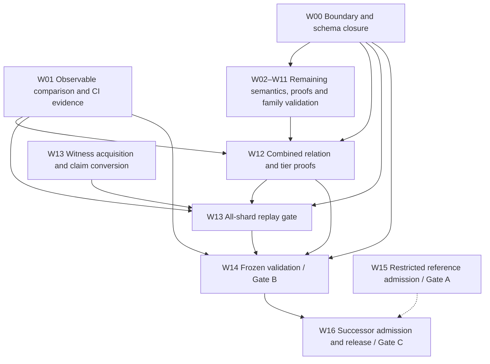

# Full Lean chunk transition — open work

Reviewed: 2026-10-25, against main `705ee41b5`.
Target: nearcore 2.13.4, commit `44f7ae6cd7ef08bab604e20a473bf77e35d4c993`, PV86,
pinned mainnet runtime parameters.

This document contains only remaining obligations. Package IDs are stable: a package stays here
while any implementation, proof, validation or admission criterion is open. Detailed historical
results belong in lane logs and evidence directories, not this backlog.
The [transition plan](LEAN_CHUNK_TRANSITION_PLAN.md) defines the authoritative gates:

- **Gate A:** restricted reference independently checked and admitted live with signed evidence.
- **Gate B:** one executable transition covers every reachable target case with protocol resource
  behaviour and complete validation; prover capacity must not exclude valid inputs.
- **Gate C:** full relation and tiers frozen, independently admitted, packaged and released.

All three gates remain open. AIR/PQ implementation, GPU proving and succinctness are not
prerequisites. Nearcore correspondence is tested unless a refinement proof is actually supplied;
candidate-to-Lean soundness and the stated checker/tier facts remain proof obligations.

## Dependency tree for parallel work

Arrows are acceptance dependencies, not instructions to wait before coding. W13 acquisition and
W15 admission auditing can proceed alongside semantic work. W12 integrates increments continuously.

| Package | Owner | Remaining focus | Close after |
|---|---|---|---|
| W00 | L0 + integration | Boundary questions, canonical predicate, fact/schema authentication | None |
| W01 | L7 + integration | Computed observables and actual CI/frozen-driver coverage | None |
| W02 | L1 | Fuel, resource limits, capacity and overlap proofs | W00 |
| W03 | Wasm owner + L7 | Remaining runtime-error/environment reachability | W00 |
| W04 | L2 | Float overlap/range proofs, preparation negatives, composition | W00 |
| W05 | L3 | Remaining curve whole-chunk coverage and parity | W00 |
| W06 | L3 key substream | secp256k1 and ML-DSA transaction/delegate keys | W00 |
| W07 | L4 | Gas-key translation, obsolete-layout distribution and composition | W00 |
| W08 | L1 + L4 | Cache identity/environment closure and broader code-policy validation | W00 |
| W09 | L5 | Independent exact-limit fixtures, observable parity and resource bounds | W00 |
| W10 | L6 | Non-genesis overlap, transaction-flag negatives, fact authentication | W00 |
| W11 | L6 resharding | Real split fixtures, mixed-protocol reachability and validation | W00 |
| W12 | Integration + L1 | Full composition, tier/overlap proofs and cross-family tests | W00–W11 |
| W13 | L7 | Executable authenticated all-shard mainnet replay | W00, W01, W12 |
| W14 | L7 + integration | Frozen full-package validation and Gate B evidence | W00, W01, W12, W13 |
| W15 | L8 | Exact restricted-reference live formal-tier admission | None |
| W16 | L8 + integration | Full successor admission and authorized release | W14 |

W07/W08 share code-resolution and cache contracts; W07/W11 share obsolete-layout routing;
W09/W11 share trie accounting. Settle shared contracts in W00 without serializing entire packages.
W06 can reuse secp arithmetic independently of W05's remaining validation. W15's dashed edge
means reusable admission tooling, not a prerequisite: W16 needs the successor's own admission.

## Acceptance requirements for outstanding work

Each remaining semantic change must satisfy transition-plan §5 and these requirements:

- Exercise executable successor paths through positive and discriminating negative whole chunks.
  Imports, standalone helpers and theorems assuming the missing semantic result are insufficient.
- Bind pinned nearcore source, toolchains, parameters, oracle/checker binaries, inputs and outputs.
  Distinguish independent native outcomes from derived expectations and Python-reference evidence.
- Cover each new branch/boundary, with deliberate-breakage controls; at least 1,000 generated
  comparisons per new semantic family across at least four recorded seeds, plus directed tests.
  Existing qualifying evidence need not be regenerated until semantic changes or freeze require it.
- Compare computed roots, outcomes, gas/compute, refunds, logs, return data, receipts, writes and
  rollback. Missing results, crashes, timeouts and unsupported valid cases cannot count as matches.
- Build changed declarations and actual drivers; audit transitive theorem axioms and runtime paths.
  Only `propext`, `Classical.choice` and `Quot.sound` are allowed logical axioms; no `sorryAx`,
  semantic axioms, verifier-result oracles or native shortcuts.
- Record exact package identity, counts/seeds, residual premises and remaining failures. Validate
  inventory rows only for the executable paths actually tested.

Shared checker, dispatch, codec, claim schema, root import and Lake target changes require one
integration owner. Preserve signed definitions and oracle pins. Do not rebuild an executable during
replay; a semantic correction invalidates affected evidence. Final whole-corpus replay is W14.

## Open packages and success criteria

### W00 Boundary inventory and schema closure

Owner: L0 + integration.

- Settle the canonical predicate and any mismatch between `Wasm.DomainD3` and actual dispatch.
  Reconcile remaining rejection guards, trusted facts, key-family rows and unresolved questions in
  the [inventory](../research/lean-chunk-coverage.md).
- Close cache/environment assumptions, activation/mixed-epoch segments, size limits, gas schedules,
  resharding witness representation and external-fact authentication. Treat `unmodeled` paths as
  proof/test obligations until justified unreachable for valid prepared inputs.
- Finalize versioned claim/witness extensions and concrete boundary-fact contracts. Computed
  transition outcomes must not be supplied as trusted substitutes for execution.
- Complete interface/semantic contracts for remaining integrations; reconcile inventory status and
  evidence against the resulting source, with unique IDs and a passing generator drift check.

Success: every open row/UQ has an owner, source-backed disposition and test/proof obligation;
no unresolved boundary assumption is relabelled complete to close Gate B.

### W01 Computed observables and CI validation

Owner: L7 + integration.

- Emit per-case **computed** roots, outcomes, gas/compute, refunds, logs, return data, receipts,
  writes and rollback from the Lean driver; compare with independent expected results.
- Add wrong-observable controls alongside existing process/verdict controls. Ensure final combined
  outputs and manifests bind every input and actual driver, including all remaining configurations.
- Obtain evidence that the pinned-corpus content gate actually runs on a provisioned runner;
  schema-only checks are not corpus-content validation.
- Exercise CI builds/tests for the final required successor modules and drivers, including the
  remaining key and real resharding paths; a YAML command alone is not execution evidence.

Success: every required case has an asserted outcome and complete observable comparison;
missing/wrong results fail; clean-run CI and package identities support W12–W14.

### W02 Protocol capacity and evaluator totality

Owner: L1.

- Prove evaluator fuel/termination suffices for valid metered execution, including all finite
  allowances and protocol-scale stack/memory use, or replace the evaluator strategy accordingly.
- Remove or justify arena-only 32-block segment and claim/witness-size limits. Versioned encodings
  must represent every valid target case; candidate budgets remain separate from validity.
- Complete below/at/above protocol-limit, overflow and out-of-gas stress comparisons; record maximum
  runtime/memory and scaling for W16 budgets.
- Prove whole-checker characterization, declared overlap agreement and tier inclusion/nesting with
  exact premises. Sampled agreement is not a proof.

Success: no valid supported execution is rejected as fuel exhaustion or a prover-derived cap.

### W03 Remaining runtime-error semantics

Owner: Wasm owner + L7.

- Resolve `WasmUnknownError` and remaining resource `LinkError` reachability with pinned-source
  arguments and tests. In particular, execution-slot retry exhaustion can yield a charged
  `LinkError`; specify/model its environment input or justify its exclusion at the target boundary.
- Define every required scheduler/concurrency/runtime-environment assumption precisely. Failure to
  construct a reproducer is not an impossibility argument.
- Validate remaining branches and phase ordering through the final combined checker, comparing
  error kind, gas, state and rollback and adding targeted breakage controls.

Success: no reachable environment failure is silently assumed absent or renamed a domain exclusion.

### W04 Float proof and composition closure

Owner: L2.

- Complete chunk-level old/new agreement on the declared overlap and formal arithmetic range/fuel
  obligations beyond existing guard lemmas and source reasoning.
- Add outstanding preparation negatives, with correct phase, gas and rollback through chunks.
- Complete full-observable and cross-family validation with crypto, global actions, genesis,
  storage accounting and other applicable successor paths under W12.

Success: remaining proofs and preparation/composition checks pass; engine agreement is not
presented as a formal IEEE/nearcore refinement theorem.

### W05 Curve whole-chunk validation

Owner: L3; coordinate with the existing curve agent.

- Generate positive and negative accepted-checker chunks for every curve entry path still lacking
  such evidence, especially all alt_bn128 and BLS hosts; establish p256 whole-chunk coverage too.
- Compare pinned gas/charge order, memory/register access, return values, state and failure kinds:
  malformed lengths/encodings, noncanonical scalars, subgroup/infinity and PV86 quirks.
- Complete independent generated family comparisons and deliberate-breakage controls where the
  package-wide acceptance contract is not yet satisfied; validate final cross-family composition.

Success: every target curve host has independent whole-chunk parity evidence. Arithmetic vectors
and reachable dispatch alone do not close the package. W06 key verification is separate.

### W06 Transaction and delegate key families

Owner: L3 key substream.

- Implement secp256k1 transaction/delegate verification, distinct from ecrecover.
- Implement ML-DSA-65 key/signature codecs, executable verification, key handles and trie integration,
  including the pinned SHA3-based public-key handle where required.
- Cover keys in actions, access-key state and receipts; integrate nonce/gas-key interactions.
- Generate valid/invalid and malformed key/signature chunks, replay/nonce negatives and algorithm
  boundaries, comparing fees, nonce changes, failures and roots.

Success: every reachable target variant decodes/verifies on each required entry path with canonical
encoding/trie parity and explicit inventory coverage.

### W07 Remaining actions and hosts

Owner: L4.

- Finish gas-key promise-host/action-log translation and coordinate required verification with W06.
- Resolve ancestor-shard routing for distribution receipts targeting obsolete layouts with W11.
  Close UQ-006: non-instant distribution alone does not prove source-receipt-proof exclusion.
- Resolve mismatched distribution code identities together with W08's cache/environment contract.
- Broaden postponed/yield, failed initialization, rollback/refund and emitted-receipt composition;
  compare full observables through the common checker and complete overlap obligations.

Success: every required promise/action shape reaches real trie-backed execution; no unexplained
host/domain exclusion remains, and fees, nonce/storage effects, receipts and rollback match nearcore.

### W08 Cache identity and environment closure

Owner: L1 + L4.

- Close historical compiled-cache coherence and mismatched `CodeHash` distribution semantics.
  Complete raw code alone does not establish equivalence with arbitrary warmed/poisoned caches.
- Specify and authenticate any necessary environment invariant, including its semantic scope.
  Remove unexplained valid-input cache exclusions; distinguish witness admission from native
  protocol rejection when code is incomplete.
- Expand cold/warm, pipelined preparation, postponed/yield, wallet redirects, committed/failed
  deployment and same-chunk call cases with complete-code policy and W09 accounting.
- Complete observable parity and overlap proofs for these paths.

Success: every required environment/code-resolution case has a deterministic justified result or
an explicitly authenticated input, with matching gas, roots and failure/rollback behaviour.

### W09 Storage boundary validation and bounds

Owner: L5.

- Generate independent nearcore whole chunks below/at/above exact per-receipt proof and chunk soft
  limits; compare execution, failure/deferral, gas, receipts and roots.
- Cover repeated/shared reads, deletion/reinsertion, large code, failed receipt rollback, implicit
  transitions, global code policy and real resharding composition.
- Justify the recorder/accounting link and remaining upper-bound assumptions; record fixture
  runtime/memory maxima and protocol-scale scaling for W02/W16.

Success: independent boundary evidence and full observable parity validate actual accounting;
local directed tests or theorems assuming the missing accounting result do not suffice.

### W10 Genesis proof and fact closure

Owner: L6.

- Prove non-genesis overlap, including the common prefix before delegation.
- Add valid/tampered genesis cases containing transactions to exercise `txValid.all`, applicable
  header/chunk-extra checks and implicit transitions.
- Authenticate genesis facts in the final W00/W16 schema and validate the final combined entry point.

Success: overlap theorem and transaction-bearing positives/negatives pass, with existing genesis
acceptance and header-mutant regressions preserved.

### W11 Resharding boundary validation

Owner: L6 resharding substream.

- Obtain validator-generated witnesses crossing a **real layout boundary**: split/no-split, both
  retention directions, nonempty state/outgoing buffers and applicable epoch updates.
- Compare intermediate/final roots, congestion, bandwidth and outputs; add corrupt witness/root/
  layout/fact negatives and compose splits with W09 recording and W07 distribution routing.
- Settle whether PV86 witnesses can reference earlier-protocol epochs or V2 layouts; implement
  required configuration/layout handling or supply a checked impossibility argument.
- Finalize authenticated/versioned boundary facts and the remaining correctness/overlap obligations
  for trie retention and the complete implicit transition.

Success: genuine split fixtures execute through the common checker and match nearcore; no valid
layout/split exclusion remains. Ordinary corpus cases labelled `c.no_resharding` are not split tests.

### W12 Full combined relation and tier proofs

Owner: integration + L1.

- Integrate remaining W02–W11 work into one executable canonical relation; every required family
  must be reachable and each tier a predicate/restriction of that relation.
- Prove checker characterization, tier inclusion/nesting and old-domain agreement. For actual
  semantic corrections, provide counterexamples and explicit successor migration rather than
  asserting false inclusion.
- Complete cross-family tests: floats/high gas, crypto/storage, global deploy/use/code/accounting,
  rollback/emitted receipts, genesis/implicit transitions and resharding/buffers/accounting.
- Validate the final generated inventory, imports, drivers and semantic closure together.

Success: full composition and proofs pass on a known buildable package, preserving signed entry
points; individual adapters and sampled verdict agreement are insufficient.

### W13 Authenticated mainnet witness replay

Owner: L7. Acquisition can proceed now; accepted final replay depends on W12.

- Expand acquisition and replay from the shard-13 diagnostic to the required all-shard window.
- Complete and validate the cold native adapter that independently verifies supplied claim facts;
  establish complete code closure and the intended cache/environment invariant for final replay.
- Resolve/document the external authentication boundary; independent finality-proof verification
  remains unimplemented. Raw witness packaging or RPC chunk payloads alone do not close acquisition.
- Execute at least **1,000 consecutive PV86 blocks across all shards**, plus targeted native fixtures
  for rare branches absent from the window, tied to inventory IDs.
- Make conversion/replay reproducible from another checkout with source/input/binary/output hashes.

Use the [replay gate and adapter contract](../../tools/mainnet-replay/README.md) and
[capture launcher](../../tools/mainnet-replay/nearcore-capture/README.md). Runtime acquisition status:
`/data/illia/nearproof-deps/mainnet-w13/home/capture-status.json`.

Success: `make w13-gate` reports **100% replay coverage, 100% verified matches, zero mismatches,
unsupported cases, missing witnesses or errors**. Include every newly included chunk across every
shard; report repeated/missed slots separately without dropping acquisition gaps.

Every run must report `mismatch_percent = 100 × mismatches / (matches + mismatches)` alongside
`replay_coverage_percent` and `verified_match_percent`. With no comparisons, mismatch is **N/A**
(JSON null), not zero. Compare recomputed state/outcome/outgoing roots, gas/balance/proposals,
congestion/bandwidth and transaction/chunk encoding commitments against anchored mainnet headers.
Native shadow acceptance is not cold native or Lean replay acceptance.

### W14 Frozen validation and Gate B

Owner: L7 + integration.

- Freeze one complete W12 package; replay D1 53,048, D2 67,384 and D3 115,284 cases with explicit
  expectations and content identities. Label regenerated replacements rather than calling them
  exact replay.
- Pass remaining per-family, generated, directed, ablation, cross-family and W13 suites on that
  package; close all UQs and valid-input research exclusions with implementation or justified
  impossibility at the target boundary.
- Perform clean builds, transitive axiom/runtime audits and resource measurements for the full
  changed closure and drivers, documenting every necessary premise.
- Publish one manifest binding code, toolchains, parameters, commands, binaries, inputs, outputs and
  resources, and an explicit Gate B completion record.

Success: the exact frozen package meets all Gate B obligations. Any subsequent source correction
requires a new identity and rerunning affected checks; successful tests do not imply formal nearcore
equivalence.

### W15 Restricted reference admission / Gate A

Owner: L8. Independent of semantic completion; inspect existing reports before expensive reruns.

- Bind the exact restricted D3alpha relation, trusted tree, parameters and exclusions to artifact hashes.
- Complete configured formal checks, artifact binding, independent kernel rechecks, public/held-out
  conformance, adversarial tests and enforced resource gates for that exact reference.
- Archive signed live **ADMITTED at formal tier** evidence with challenge/submission/run IDs and
  verifier digest. Keep held-out cases/seeds private and report only aggregates.
- Verify clean-checkout contributor instructions and accurate coverage/resource reporting;
  re-execution is not succinctness without enforced signed thresholds.

Success: exact-package live signed evidence closes Gate A; local/unsigned PASS is insufficient.

### W16 Full successor admission and release / Gate C

Owner: L8 + integration. Documentation can proceed now; freeze/release follows W14.

- Freeze the full trusted relation, proved tiers, canonical claim/witness encoding, public binding
  and authenticated external-fact provenance.
- Pin the successor challenge's oracle, workloads, held-out commitment, resource profile, semantic
  coverage and measured scoring baseline. Candidate budgets must not narrow canonical validity.
- Independently pass every applicable Gate A check for the exact successor reference and obtain
  its own signed, artifact-bound live formal-tier admission.
- Demonstrate contributor instructions for another proof system proving the same statement and
  declaring partial coverage without changing the trusted relation.
- Complete authorized signing/deployment/publication, with release identity and explicit Gate C
  evidence. This workplan does not itself authorize external release.

Success: the frozen full successor is independently admitted and reproducibly released.
